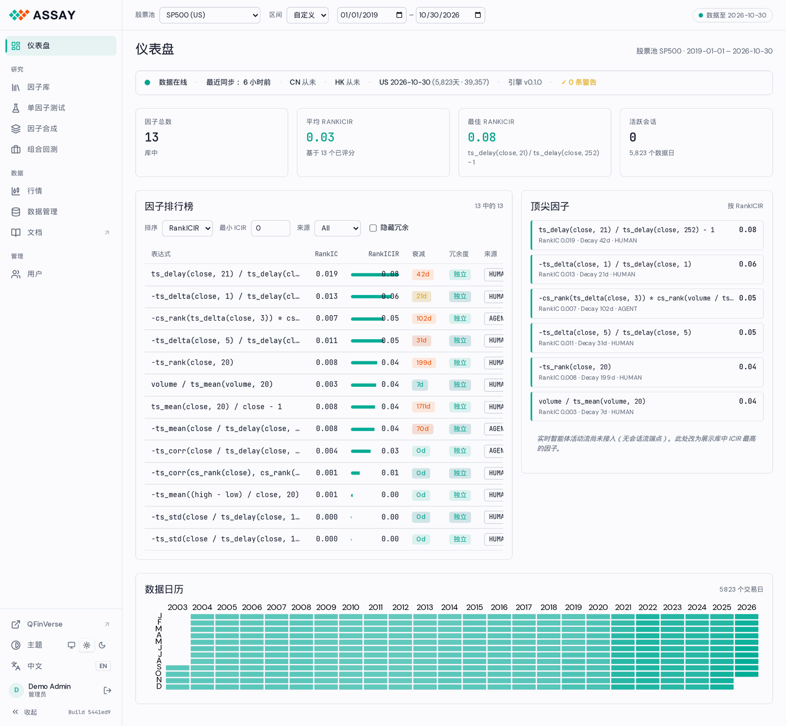
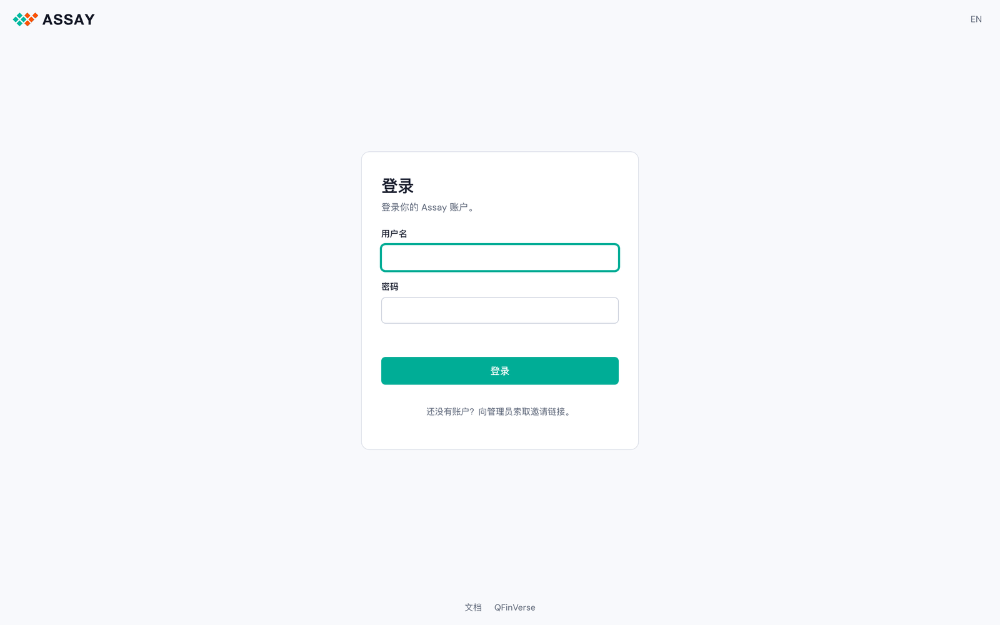
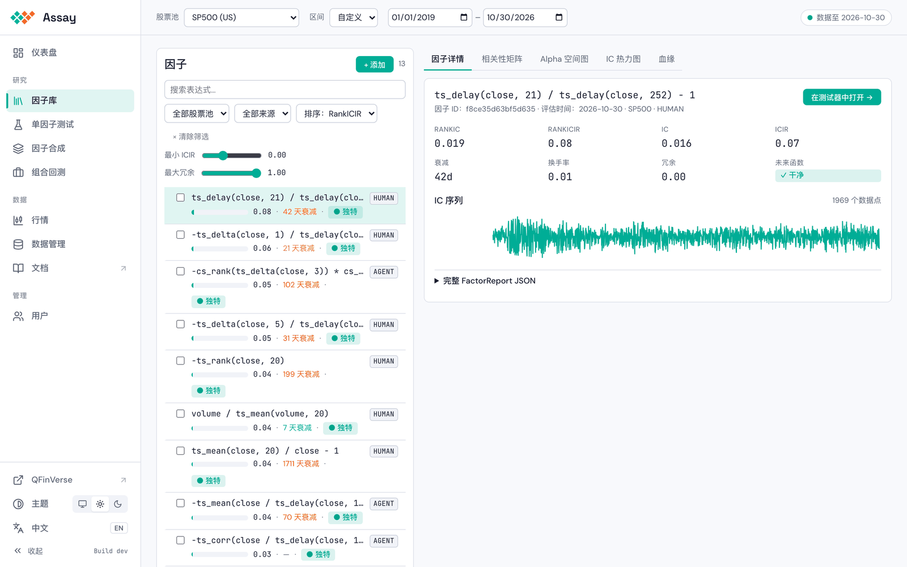
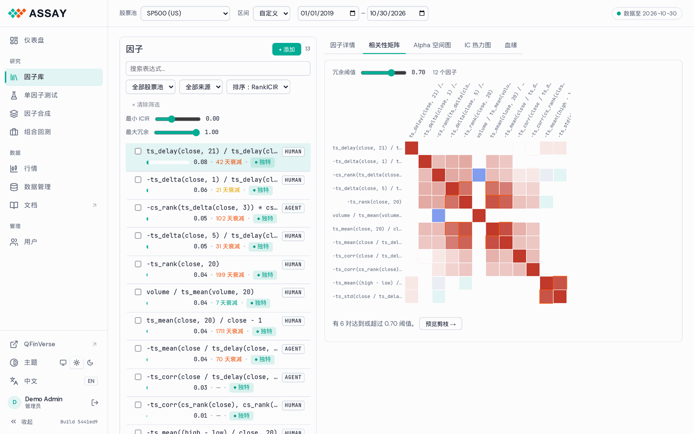
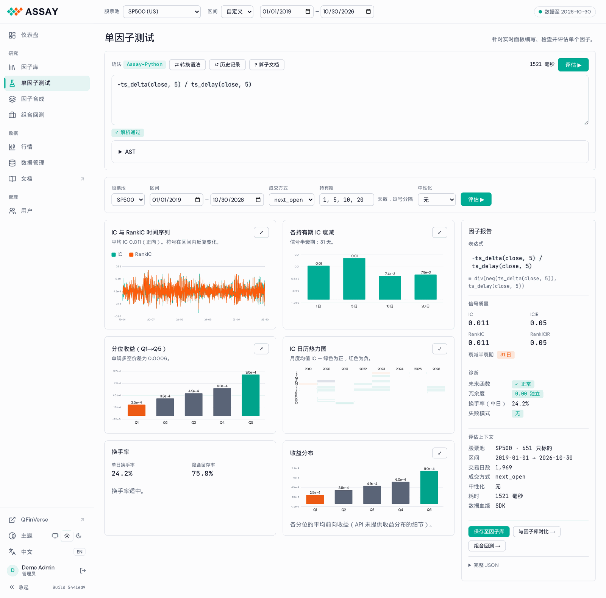

# Assay WebUI — 详细设计

**版本：** 0.2 · 2026-11  
**范围：** 已上线控制台的全部页面  
**技术栈（已上线）：** 原生 JS 模块 + 手写 SVG 图表，无需构建 —— [`src/assay/api/static/`](../../../src/assay/api/static/)

> **现状（2026-11）。** 上线的控制台是由 FastAPI 直接提供的免构建应用，页面包括：仪表盘、
> 因子库（详情、相关性矩阵、Alpha 空间图、IC 热力图、血缘）、单因子测试、因子合成、组合回测、
> 行情、数据管理、账户和用户。界面与 QFinVerse 一致（左侧栏、浅色/深色、EN / 中文）；设置
> `ASSAY_ACCOUNTS=1` 时启用邀请制账户。本文的截图都来自这个应用。
>
> 第 6–10 节（React 组件、状态、hooks、Monaco）描述的是最初规划的 React 版本，作为组件行为的
> 参考保留，不是上线的代码。
>
> - 股票池：QFinVerse 数据上的 TOP500 / TOP1000 / TOP3000、SP500 和 NASDAQ100；导入了 Tushare
>   数据时还有沪深300 / 500 / 1000 和 HK100。
> - 美股日线只有 OHLCV 和成交笔数，没有 `vwap` 字段。
> - 尚未接入：仪表盘上的实时 agent 信息流（还没有 session-stream 接口）。
> - 诊断码和 `failure_mode` 取自 `assay.engine.diagnostics`（`SYNTAX_ERROR` · `LOOKAHEAD` ·
>   `CONSTANT` · `ALL_NAN` · `RUNTIME_ERROR`；代码 `ASSAY-P###/E###/O###`）。

---

## 目录

1. [信息架构](#1-information-architecture)
2. [全局外壳](#2-global-shell)
3. [仪表盘](#3-dashboard)
4. [因子库分析](#4-factor-library-analysis)
5. [单因子测试](#5-single-factor-test)
6. [共享组件](#6-shared-components)
7. [状态管理](#7-state-management)
8. [数据获取与流式传输](#8-data-fetching--streaming)
9. [Monaco 编辑器扩展](#9-monaco-editor-extension)
10. [路由](#10-routing)
11. [设计令牌](#11-design-tokens)

---

## 1. 信息架构

```
#/dashboard            仪表盘
#/library              因子库（标签：详情、矩阵、Alpha 空间图、IC 热力图、血缘）
#/factor               单因子测试（空白编辑器）
#/factor/:factor_id    单因子测试（预载因子）
#/combination          因子合成
#/portfolio            组合回测（#/portfolio/:factor_id 预载因子）
#/chart                行情
#/data                 数据管理（管理员）
#/account              账户：资料、密码、API 密钥
#/users                用户与邀请（管理员）
/login                 登录、凭邀请注册、重置密码、创建首个管理员
/doc/                  Doc Hub（独立页面）
```

所有路由共享的 URL 参数（全局状态，同步到 URL）：

```
?universe=NASDAQ100
&period_start=2020-01-01
&period_end=2024-12-31
```

---

## 2. 全局框架



### 2.1  布局

左侧是侧栏，右侧是页面，与 QFinVerse 控制台一致。每个页面顶部有一条吸顶的上下文栏。页面滚动时，侧栏和上下文栏保持不动。

### 2.2  侧栏

宽 224 px；点「收起」后只显示 60 px 宽的图标（按浏览器记住）。

| 元素 | 行为 |
|---|---|
| QFinVerse 标志 + "Assay" | 回到仪表盘 |
| 仪表盘 | 顶部链接 |
| 研究 | 因子库 · 单因子测试 · 因子合成 · 组合回测 |
| 数据 | 行情 · 数据管理（管理员） · 文档（在新标签页打开 Doc Hub） |
| 管理 | 用户（仅管理员） |
| QFinVerse | 在新标签页打开 QFinVerse 控制台 |
| 主题 | 跟随系统 / 浅色 / 深色；与 QFinVerse 共用（`qfv-theme`） |
| 语言 | English / 中文 |
| 用户行 | 显示名和角色，点击进入「账户」；旁边的图标退出登录 |
| Build | 当前部署的 `Build <commit>`；悬停显示引擎版本和部署时间 |

当前页面所在的行有底色和 3 px 的强调色竖条。

### 2.3  上下文栏

| 元素 | 行为 |
|---|---|
| 股票池 | 有数据的股票池可选，其余标为「即将」 |
| 区间 | 1Y / 3Y / 5Y 预设，或自定义起止日期 |
| 状态标签 | 显示「数据至 <最后日期>」；绿色表示新鲜，黄色表示陈旧或降级，红色表示连不上。点击回到仪表盘 |

股票池和区间是全局的：保存在 URL 和浏览器里，所有页面都读它们。修改它们不会重跑正在进行的评估。

### 2.4  登录

开启账户后，未登录的访问会被引到 `/login`，登录后回到原页面。同一个页面还负责凭邀请注册（`?invite=`）、重置密码（`?reset=`），以及在新服务器上创建第一个管理员。



---

## 3. 仪表盘

### 3.1  页面布局

页面见第 2 节的截图。

### 3.2  StatusBar

仪表盘页面顶部的一条细栏：数据状态、最近同步、各市场覆盖、引擎版本和数据告警。

- 绿点 = 完全同步，琥珀色 = 陈旧，红色 = 错误
- 点击 "2 warnings" 会展开一个内联告警面板，列出具体的数据质量问题
- 该条在仪表盘页面的滚动容器内保持固定（sticky）

### 3.3  指标卡

四张等宽的卡片：因子库中的因子总数、平均 RankICIR、最佳 RankICIR（附表达式）、活跃会话（附数据天数）。标签是小号大写的灰色文字，数值用等宽字体。

### 3.4  因子排行榜

左列（60%），显示按 RankICIR 排序的前 100 个因子。

#### 控件（表格上方）

- 排序下拉框：RankICIR（默认）、IC、衰减半衰期、评估日期
- 最小 ICIR 过滤器：滑块 + 数字输入框，0.0–2.0
- 来源过滤器：All、AGENT、HUMAN、WQ101、IMPORTED
- 隐藏冗余开关：过滤掉 `redundancy_score > 0.7` 的因子

#### 表格列

| 列 | 来源字段 | 宽度 | 行为 |
|---|---|---|---|
| Expression | `expr`（截断至 40 字符） | flex | 悬停时工具提示显示完整表达式 |
| RankIC | `rank_ic` | 72px | 右对齐，保留 3 位小数 |
| RankICIR | `rank_icir` | 80px | 右对齐，内联条形叠加 |
| Decay | `decay_halflife_days` | 64px | `Xd` 格式，颜色：绿色 < 10d，琥珀色 10–30d，红色 > 30d |
| Redundancy | `redundancy_score` | 72px | 彩色徽章：绿色 < 0.4，琥珀色 0.4–0.7，红色 > 0.7 |
| Source | `lineage.source` | 80px | 小标签徽章 |
| Status | `failure_mode` | 64px | 绿色对勾或红色 `!` 徽章 |

表格行为：
- 点击任意行 → 导航到 `/factor/:factor_id` 并预加载该因子
- 悬停任意行 → 显示一个带 IC 迷你走势图（最近 60 天）的小预览弹出框
- 表格采用虚拟化（react-virtual）以保证 1000+ 行时的性能
- 表头固定

### 3.5  Agent 活动信息流

右列（40%）。在当前或最近的 agent session 中触发的因子评估的实时信息流。

#### Session 摘要面板（信息流顶部）

> 尚未接入：还没有 session-stream 接口。右栏目前显示因子库里 RankICIR 最高的因子（见第 2 节截图）。本节其余内容是目标设计。

#### 信息流条目

每个条目是一张卡片，包含：

- 新条目从顶部动画进入（CSS 下滑过渡）
- 最多可见 50 个条目；较旧的条目在底部淡出
- 失败的评估以红色左边框和 `failure_mode` 代码显示
- 点击任意条目 → 导航到 `/factor/:factor_id`
- "Pause feed" 开关冻结自动滚动，以便用户阅读

轮询：新条目通过对 `GET /v1/events/session-stream` 的 SSE 订阅获取。

### 3.6  数据日历

排行榜 + 信息流行下方的全宽条带。一个类 GitHub 贡献热力图，按交易日显示数据可用性。

单元格颜色：
- 深绿：100% 覆盖率（所有标的都有数据）
- 中绿：> 95% 覆盖率
- 琥珀色：80–95% 覆盖率
- 红色：< 80% 覆盖率
- 浅灰：非交易日（周末 / 假日）

交互：
- 悬停单元格 → 工具提示：`Dec 15 2024  101/101 symbols  Last sync: 21:05 UTC`
- 点击红色/琥珀色单元格 → 在日历下方展开一个内联数据质量面板，列出缺失的标的
- 左侧的年份标签可点击以滚动到该年份

---

## 4. 因子库分析

### 4.1  页面布局



左右分栏可调整大小——用户可在 25%–50% 之间拖动分隔条。

### 4.2  模式标签页

五个标签：因子详情、相关性矩阵、Alpha 空间图、IC 热力图、血缘。

模式状态以 `?mode=matrix` 的形式持久化到 URL 中。

### 4.3  因子列表（左面板）

#### 过滤栏

- 全文搜索针对表达式字符串运行（小型库时在客户端，> 500 个因子时在服务端）
- 滑块在释放时（而非拖动时）更新结果，以避免过多的 API 调用
- "Clear filters" 按钮上带有激活过滤器数量徽章

#### 列表项

- 用于多选的复选框
- 等宽字体的表达式，截断显示，完整文本在工具提示中
- ICIR 显示为水平条（填充比例 = ICIR / 2.0，为最大刻度）
- 衰减半衰期
- 冗余度徽章：`● unique`（绿色）、`◐ similar`（琥珀色）、`● redundant`（红色）
- 来源标签：`AGENT`、`HUMAN`、`WQ101`、`IMPORTED`
- 点击项主体：选中它并更新右面板
- 点击复选框：加入多选而不改变右面板

选中项带有蓝色左边框。激活项（最后点击的）带有略深的背景。

#### 批量操作栏（当勾选 ≥ 1 项时出现）

- Export：为所选因子下载 FactorReport JSON 或 CSV
- Tag：下拉框以添加标签（新建或选择已有）
- Compare：切换到相关性矩阵模式，预填入所选因子
- Delete：显示列出表达式的确认弹窗；确认删除后调用 `DELETE /v1/library/factors`

### 4.4  模式 A — 因子详情

默认模式。当从列表中选中一个因子时显示。

右面板布局：

详情面板见 4.1 节的截图。

"Open in tester →" 按钮导航到 `/factor/abc123`。

### 4.5  模式 B — 相关性矩阵

整个右面板是一张热力图。



热力图：
- 行和列为因子表达式（截断显示）
- 单元格颜色：发散色阶，红色 = 高正相关，白色 = 0，蓝色 = 高负相关
- 阈值叠加：高于滑块值的单元格获得红色对角划线
- 当 "Cluster" 打开时，因子按层次聚类重新排序（在客户端使用 `ml-hclust` 库的 hclust 计算）
- 悬停任意单元格：工具提示显示 `ts_corr... × cs_rank...  correlation: 0.83`
- 点击任意单元格：打开两个因子每日值的散点图弹窗

热力图下方的摘要：

"Preview pruning" 打开一个侧抽屉，列出将被移除的 8 个因子，在每一对中保留 RankICIR 较高的那个。

### 4.6  模式 C — Alpha 空间图

整个右面板是一张 2D 散点图。

每个点的位置通过对成对秩相关距离矩阵（1 - |corr|）运行 UMAP 计算得出。行为相似的因子聚集在一起；正交的因子相距较远。

图形：
- 每个点是一个因子
- 默认：颜色 = RankICIR（绿 → 黄 → 红色阶），大小 = 固定
- "Color by" 选项：RankICIR、来源（AGENT/HUMAN/WQ101）、衰减半衰期、冗余度
- 悬停：带表达式、RankICIR、衰减的工具提示
- 点击：选中因子，将左面板切换到该因子，如果分栏视图处于激活状态则同时在模式 A 面板中显示详情
- "Show gaps" 叠加层：绘制现有点的凸包并高亮空白的内部区域——这些是 agent 应当瞄准的未探索 alpha 区域
- 支持平移和缩放（d3-zoom）

UMAP 在页面加载时或因子集变化时使用 `umap-js` 在客户端计算。对于 > 300 个因子会出现加载旋转指示器（通常 1–3 秒）。

### 4.7  模式 D — IC 热力图

整个右面板。一个矩阵，其中行 = 因子，列 = 交易日期，单元格 = 当天的 IC 值。

- 行是与左面板列表相同顺序的因子（遵循当前过滤器）
- 列是交易日，按月分组
- 颜色：正 IC 为绿色，负 IC 为红色，~0 为白色
- 色阶滑块设置饱和度锚点（默认 ±0.15 = 满红/满绿）
- 悬停单元格：`Factor: ts_corr(close,volume,20)  Date: Nov 15 2024  IC: 0.061`
- 点击行标签：在左面板中选中因子，在模式 A 中显示详情

此视图让市场状态（regime）效应一目了然——一条竖直的红色带意味着所有因子在那些日期都失效了（市场事件）。一条水平的红色带意味着某一个因子持续失效。

### 4.8  模式 E — 因子血缘

一张展示因子来源的有向图。

节点：
- `[PROMPT]` — LLM prompt（显示模型、时间戳、prompt 哈希）
- `[FACTOR]` — 因子表达式（显示表达式、RankICIR）
- `[SNAPSHOT]` — 用于评估的数据快照

边：
- `[PROMPT] → [FACTOR]` — "generated"
- `[FACTOR] + [SNAPSHOT] → [FACTOR]` — "evaluated on"

布局：使用 dagre 布局算法的自上而下 DAG。

交互：
- 悬停节点：带完整细节的工具提示
- 点击 `[FACTOR]` 节点：在左面板中选中，在模式 A 中显示详情
- 点击 `[PROMPT]` 节点：打开带完整 prompt 文本的弹窗
- 双击 `[SNAPSHOT]` 节点：打开过滤到该快照日期的数据日历

---

## 5. 单因子测试

### 5.1  页面布局



在窄屏（< 1200px）上，摘要面板移动到结果网格下方，且结果网格变为 1 列。

### 5.2  表达式编辑器

一个占据约 180px 高度（4–6 行）的 Monaco 编辑器实例。可通过拖动底边调整大小。

#### 编辑器上方的工具栏

- 语法切换：显示当前激活的语法；点击可切换高亮模式
- 转换语法：在 qlib 与 Python 语法之间重写当前表达式（在进程内调用 `syntax-bridge` 工具，无 API 调用）
- 评估按钮：触发评估；点击后显示加载旋转指示器，完成时替换为延迟徽章（例如 `342ms`）
- 历史：最近 20 个已评估表达式的下拉框，点击可恢复
- 算子文档：打开一个抽屉，以可搜索的参考形式展示完整的 `OPERATOR_SCHEMA`

#### 编辑器行为

- 默认高度：4 行（随内容展开至最多 8 行后开始滚动）
- 键盘快捷键：`Cmd+Enter`（Mac）/ `Ctrl+Enter`（Windows）触发评估
- 带有 `factor_id` 路由参数加载时：编辑器预填充该因子的表达式
- 语法错误下划线随用户输入出现，来源为在 Web Worker 中运行的解析器
- AST 树渲染在编辑器正下方的可折叠面板中，默认隐藏；"AST" 展开链接可切换其显示

#### AST 展开面板

渲染为缩进树。节点类型使用不同颜色：FieldNode（青绿色）、LitNode（琥珀色）、OpNode（蓝色）、BinOp（灰色）。

### 5.3  配置行

编辑器下方的一条水平条带，带有六个控件。控件紧凑（高度 36px）。

| 控件 | 选项 | 备注 |
|---|---|---|
| 股票池 | 继承自全局状态；显示当前值；可按每次评估覆盖 | 在此更改不会更新全局状态 |
| 周期 | 继承自全局状态；可覆盖 | 同上 |
| 执行 | `next_open`（默认）、`next_close` | 工具提示解释每一项。`vwap` 被禁用——MASSIVE 日聚合数据源没有日内/VWAP 数据 |
| 时间跨度 | 多选复选框：1d、5d、10d、20d（全部默认选中） | 影响衰减曲线范围 |
| 中性化 | None（默认）、Sector、Industry、Market cap | 在计算 IC 前应用 `cs_neutralize` |
| 评估按钮 | 主要行动号召，也可由 `Cmd+Enter` 触发 | 完成时延迟徽章替换旋转指示器 |

当股票池或周期与全局状态不同时，控件会显示一个小的 `*` 指示器和一个工具提示："此评估使用了与你的全局设置不同的股票池/周期。"

### 5.4  结果网格

以 2×3 网格排列的六张图表卡片。图表卡片共享一个通用的卡片外壳：

- 标题：14px，中等字重
- 解读提示：12px 弱化文字，单行，根据结果更新
- `↓` 下载图标：将图表数据导出为 CSV
- 图表区域填充剩余空间；最小高度 220px

图表渐进式渲染——每张卡片在其数据通过 SSE 到达前显示加载骨架屏。

#### 卡片 1 — IC 与 RankIC 时间序列

**图表类型：** 折线图（Recharts `LineChart`）

**数据：** 来自 `eval.ic_series` SSE 事件的 `ic[]`、`rank_ic[]`、`dates[]`

**系列：**
- IC：蓝色细线（1.5px）
- RankIC：青绿色细线（1.5px）
- 滚动 63 日均值 IC：蓝色粗线（3px）
- ±0.02 显著性带：浅灰色填充区域

**坐标轴：**
- X：交易日期，月度刻度，缩写的月份标签
- Y：默认范围 [-0.15, 0.15]；若值超出则自动缩放

**注释：**
- 在主要市场事件处的垂直虚线（2020 年 3 月 COVID 崩盘、2022 年美联储加息）；通过 "Show events" 复选框切换
- 卡片头部的摘要统计：`IC: 0.032  ICIR: 0.43  RankIC: 0.047  RankICIR: 0.61`

**解读提示：** `"Consistent positive signal. IC is stable across the period."` / `"Unstable IC — signal reverses in bear markets."`

#### 卡片 2 — 衰减曲线

**图表类型：** 柱状图（Recharts `BarChart`）

**数据：** 来自 `eval.decay` SSE 事件的 `ic_by_horizon`、`halflife`

**柱：**
- 每个时间跨度一根柱（1d、5d、10d、20d）
- 柱高 = 该时间跨度下的 RankIC
- 误差线（细线）显示每个时间跨度下每日 IC 的 ±1 标准差

**叠加线：**
- 指数衰减拟合：穿过柱顶的虚线
- 半衰期注释：指向 50% IC 水平的标注标签

**解读提示：** `"Signal half-life: 12 days. Suitable for weekly rebalancing."`

#### 卡片 3 — 分组收益分析

**图表类型：** 带可选叠加线的柱状图

**数据：** 来自 `eval.groups` SSE 事件的 `quintile_returns`

**柱：**
- 5 根柱，每个五分位一根（Q1 = 做空，Q5 = 做多）
- 颜色：Q1 红色，Q2–Q4 灰色，Q5 绿色
- 每根柱上方的数值标签（例如 `-0.12%`、`+0.15%`）

**图表上方的控件：**
- 收益类型切换：`Raw` / `Market-adjusted` / `Sector-adjusted`
- 时间跨度选择器（1d、5d、10d、20d）——更改时更新图表

**叠加线：** 多空价差（Q5 − Q1），显示在次 Y 轴上

**解读提示：** `"Monotonic spread of 0.27%/day long-short. Strong signal."` / `"Non-monotonic — Q3 outperforms Q5. Factor may be non-linear."`

#### 卡片 4 — 因子热力图

**图表类型：** 自定义 SVG 日历热力图

**数据：** 来自 `eval.ic_series` SSE 事件的 `ic[]`、`dates[]`（与卡片 1 相同的数据）

**布局：**
- 列：交易日，每天一个单元格，4px 宽
- 行：每年一行
- 月份标签在顶部；年份标签在左侧
- 单元格颜色：绿色（正 IC）→ 白色（零）→ 红色（负 IC），对称的发散色阶

**交互：**
- 悬停单元格：工具提示 `Dec 15 2024  IC: 0.061`
- 通过图表下方的小滑块调整色阶（默认 ±0.10）

**解读提示：** `"Strong in 2021–2022. Signal weakens post-2023 rate hikes."`

#### 卡片 5 — 换手率分析

**图表类型：** 双轴折线图

**数据：** 由 `factor_vals`（秩自相关）和成本模型计算得出

**系列：**
- 主 Y 轴：63 日滚动秩自相关（蓝色线）
- 次 Y 轴：扣除交易成本后的估计净 IC（橙色虚线）

**参考线：** 在 `autocorr = 0.8`（典型的"低换手率"阈值）处的水平线

**图表下方的摘要：**
```
Avg autocorrelation: 0.83  ·  Estimated cost drag: 0.008 IC  ·  Net IC: 0.039
```

**解读提示：** `"Low turnover factor. Transaction costs consume ~17% of gross IC."`

#### 卡片 6 — 收益分布

**图表类型：** 叠加直方图（带两个数据系列的 Recharts `BarChart`）

**数据：** Q1（做空）和 Q5（做多）五分位的远期收益分布

**系列：**
- Q5（做多）收益：绿色柱，40% 不透明度
- Q1（做空）收益：红色柱，40% 不透明度
- 叠加在每个直方图上的 KDE 平滑线（通过 `kernel-density-estimator` 工具计算）

**图表下方的统计面板：**
```
                 Q5 (Long)    Q1 (Short)
Mean return:     +0.0015      -0.0012
Std dev:          0.0089       0.0091
t-statistic:     2.34  (p < 0.02)
```

**解读提示：** `"Distributions well-separated. Long-short return is statistically significant."`

### 5.5  摘要面板

固定 300px 的右列。显示结构化的 FactorReport。

#### 加载状态

评估进行中时：为每个部分显示加载骨架屏。

#### 已填充状态

- "Save to library" 按钮：调用 `POST /v1/library/factors`，显示成功 toast
- "Compare with library →" 按钮：导航到 `/library?mode=matrix`，将此因子预填入相关性矩阵，与库中 RankICIR 排名前 20 的因子对比
- "Full JSON" 展开项：展开一个 `<pre>` 块，包含完整的 `FactorReport` JSON，带语法高亮和复制按钮

#### 错误状态（当设置了 `failure_mode` 时）

从引擎的 `FactorDiagnostics`（`diagnose().to_dict()` 的 `errors[]` / `warnings[]` 数组）渲染。头部是诊断 `title`，代码徽章是稳定的 `ASSAY-*` id，主体是 `message` + 插入符号 `snippet`，修复行是 `suggestion`。示例——一个真实的 `LOOKAHEAD_SHIFT`（`failure_mode: LOOKAHEAD`）：

`failure_mode` 是 `SYNTAX_ERROR` · `LOOKAHEAD` · `CONSTANT` · `ALL_NAN` ·
`RUNTIME_ERROR` 之一；解析错误（`ASSAY-P###`）也会内联显示在编辑器中（§9）。
错误状态会替换整个摘要面板的内容。在错误被检测到之前，图表仍会用任何可用的部分数据进行渲染。

---

## 6. 共享组件

### 6.1  `<FactorReportCard />`

在排行榜和 agent 信息流中使用的紧凑卡片。接受一个 `FactorSummary` 或 `FactorReport` 属性。

```typescript
interface FactorReportCardProps {
  factor:    FactorSummary | FactorReport
  compact?:  boolean          // true = no sparkline, 1 line height
  onClick?:  () => void
  selected?: boolean
}
```

### 6.2  `<ICSparkline />`

一个极简的 60 天 IC 走势图。用于排行榜悬停预览和因子详情卡片。

```typescript
interface ICSparklineProps {
  ic:        number[]   // last 60 values
  width?:    number     // default 120
  height?:   number     // default 32
  color?:    string     // default: blue if mean > 0, red if mean < 0
}
```

### 6.3  `<RedundancyBadge />`

```typescript
interface RedundancyBadgeProps {
  score:          number          // 0.0–1.0
  nearestFactor?: FactorSummary  // shown in tooltip if redundant
}
// Renders: "● unique" (score < 0.4), "◐ similar" (0.4–0.7), "● redundant" (> 0.7)
```

### 6.4  `<ExpressionTag />`

一个显示截断因子表达式的等宽字体药丸标签。悬停时工具提示显示完整表达式。

```typescript
interface ExpressionTagProps {
  expr:      string
  maxChars?: number    // default 40
  onClick?:  () => void
}
```

### 6.5  `<FactorReportJSON />`

带复制按钮和行数徽章的语法高亮 JSON 显示。

```typescript
interface FactorReportJSONProps {
  report:  FactorReport
  maxHeight?: number    // default 400, scroll if taller
}
```

### 6.6  `<SkeletonChart />`

大小与图表卡片匹配的动画加载骨架屏。在 SSE 事件待处理时使用。

```typescript
interface SkeletonChartProps {
  height?:  number  // default 220
  type?:    "line" | "bar" | "heatmap"  // affects skeleton shape
}
```

---

## 7. 状态管理

所有状态都在 Zustand store 中。不使用 Redux。不使用 Context API 管理状态（仅用于 DI/配置）。

### 7.1  全局 store

```typescript
// src/store/global.ts

interface GlobalState {
  // User-controlled global settings
  universe:         string               // "NASDAQ100"
  period:           [string, string]     // ["2020-01-01", "2024-12-31"]
  sessionId:        string | null        // created after universe/period set
  sessionSetupMs:   number | null        // how long session creation took

  // Actions
  setUniverse:      (u: string) => void
  setPeriod:        (p: [string, string]) => void
  createSession:    () => Promise<void>
  invalidateSession:() => void
}
```

### 7.2  库 store

```typescript
// src/store/library.ts

interface LibraryState {
  // Client-side cache of library factors (augments React Query)
  savedFactorIds:  Set<string>         // factors the user saved in this session
  selectedIds:     Set<string>         // multi-select state
  activeFactorId:  string | null       // currently viewed factor in detail panel
  activeMode:      LibraryMode         // "detail" | "matrix" | "map" | "heatmap" | "lineage"
  filters:         LibraryFilters

  // Actions
  selectFactor:    (id: string) => void
  toggleSelect:    (id: string) => void
  clearSelect:     () => void
  setMode:         (mode: LibraryMode) => void
  setFilters:      (f: Partial<LibraryFilters>) => void
  markSaved:       (id: string) => void
}
```

### 7.3  评估 store

```typescript
// src/store/evaluation.ts

interface EvalState {
  // Current evaluation in the Single Factor Test page
  expr:            string
  isEvaluating:    boolean
  events:          EvalEvent[]          // streaming events received so far
  report:          FactorReport | null  // set when eval.complete arrives
  error:           EvalError | null
  latencyMs:       number | null

  // History (last 20 evaluations in this session)
  history:         Array<{ expr: string; report: FactorReport }>

  // Actions
  setExpr:         (expr: string) => void
  startEval:       () => void
  appendEvent:     (e: EvalEvent) => void
  completeEval:    (report: FactorReport, ms: number) => void
  setError:        (e: EvalError) => void
  clearResults:    () => void
  restoreFromHistory: (idx: number) => void
}
```

---

## 8. 数据获取与流式传输

React Query 管理所有服务端状态。自定义 hook 封装了 fetch + SSE 逻辑。

### 8.1  查询键

```typescript
// Consistent key structure for cache invalidation
const queryKeys = {
  system:    {status: ["system", "status"], calendar: (year: number) => ["system", "calendar", year]},
  library:   {list: (filters: LibraryFilters) => ["library", "list", filters],
              factor: (id: string) => ["library", "factor", id],
              correlation: (ids: string[]) => ["library", "corr", ids.sort().join(",")],
              alphaSpace: (ids: string[]) => ["library", "umap", ids.sort().join(",")]},
  session:   {create: (u: string, p: string) => ["session", u, p]},
}
```

### 8.2  评估流式 hook

```typescript
// src/api/hooks/useEvaluate.ts

export function useEvaluate() {
  const store = useEvalStore()
  const global = useGlobal()

  const evaluate = useCallback(async (overrides?: Partial<EvalRequest>) => {
    const req: EvalRequest = {
      expr:      store.expr,
      universe:  global.universe,
      period:    global.period,
      horizons:  [1, 5, 10, 20],
      stream:    true,
      session_id: global.sessionId,
      ...overrides,
    }

    store.startEval()
    const startMs = Date.now()

    try {
      const res = await fetch("/v1/factor/evaluate", {
        method:  "POST",
        headers: { "Content-Type": "application/json", "X-API-Key": getApiKey() },
        body:    JSON.stringify(req),
      })

      if (!res.ok) {
        const err = await res.json()
        store.setError(err.error)
        return
      }

      const reader = res.body!.getReader()
      const decoder = new TextDecoder()
      let buffer = ""

      while (true) {
        const { done, value } = await reader.read()
        if (done) break

        buffer += decoder.decode(value, { stream: true })
        const lines = buffer.split("\n")
        buffer = lines.pop() ?? ""          // keep incomplete line in buffer

        for (const line of lines) {
          if (!line.startsWith("data: ")) continue
          const event = JSON.parse(line.slice(6)) as EvalEvent
          store.appendEvent(event)

          if (event.type === "eval.complete") {
            store.completeEval(event.data as FactorReport, Date.now() - startMs)
          }
        }
      }
    } catch (e) {
      store.setError({ code: "NETWORK_ERROR", message: String(e) })
    }
  }, [store, global])

  return { evaluate, isEvaluating: store.isEvaluating, events: store.events }
}
```

### 8.3  库查询

```typescript
// src/api/hooks/useLibrary.ts

export function useLibraryList(filters: LibraryFilters) {
  return useQuery({
    queryKey: queryKeys.library.list(filters),
    queryFn:  () => api.library.list(filters),
    staleTime: 30_000,    // 30s — library changes slowly
    refetchOnWindowFocus: true,
  })
}

export function useCorrelationMatrix(factorIds: string[], universe: string) {
  return useQuery({
    queryKey: queryKeys.library.correlation(factorIds),
    queryFn:  () => api.library.correlationMatrix(factorIds, universe),
    enabled:  factorIds.length >= 2,
    staleTime: 5 * 60_000,   // 5 min — correlation is expensive to compute
  })
}
```

---

## 9. Monaco 编辑器扩展

### 9.1  语言注册

```typescript
// src/components/editor/assay-lang.ts

export function setupAssayLanguage(schema: OperatorSchema) {
  monaco.languages.register({ id: "assay" })

  // ── Token rules ──────────────────────────────────────────────
  monaco.languages.setMonarchTokensProvider("assay", {
    tokenizer: {
      root: [
        [/\$[a-z_]+/,                      "variable.predefined"],   // $close
        [/\b(ts_|cs_|calc_)[a-z_]+\b/,     "keyword"],               // ts_mean
        [/\b(Ref|Mean|Std|Corr|EMA|Rank|Delta|Resi|Sum|Product|IdxMax|IdxMin)\b/, "keyword.control"],
        [/\b(open|high|low|close|volume|transactions)\b/,  "variable"],  // MASSIVE day-agg fields; no vwap/market_cap
        [/\d+(\.\d+)?/,                    "number"],
        [/[+\-*/().,<>?:]/,               "operator"],
        [/"[^"]*"/,                        "string"],
      ]
    }
  })

  // ── Autocomplete ─────────────────────────────────────────────
  monaco.languages.registerCompletionItemProvider("assay", {
    triggerCharacters: ["(", "_"],
    provideCompletionItems(model, position) {
      const wordInfo = model.getWordUntilPosition(position)
      const range = {
        startLineNumber: position.lineNumber,
        endLineNumber:   position.lineNumber,
        startColumn:     wordInfo.startColumn,
        endColumn:       wordInfo.endColumn,
      }

      const operatorSuggestions = Object.entries(schema).map(([name, op]) => ({
        label:            name,
        kind:             monaco.languages.CompletionItemKind.Function,
        documentation:    { value: `**${op.signature}**\n\n${op.description}\n\n*Output: ${op.output_range}*` },
        detail:           op.signature,
        insertText:       op.insert_snippet,   // "ts_corr(${1:x}, ${2:y}, ${3:d})"
        insertTextRules:  monaco.languages.CompletionItemInsertTextRule.InsertAsSnippet,
        range,
        sortText:         "0" + name,          // operators appear above fields
      }))

      const fieldSuggestions = ["close","open","high","low","volume","transactions"].map(f => ({
        label:    f,
        kind:     monaco.languages.CompletionItemKind.Field,
        detail:   "data field",
        insertText: f,
        range,
        sortText: "1" + f,
      }))

      return { suggestions: [...operatorSuggestions, ...fieldSuggestions] }
    }
  })

  // ── Signature help (parameter hints) ─────────────────────────
  monaco.languages.registerSignatureHelpProvider("assay", {
    signatureHelpTriggerCharacters:   ["("],
    signatureHelpRetriggerCharacters: [","],
    provideSignatureHelp(model, position) {
      // Walk backwards from cursor to find enclosing function name and arg index
      const { fnName, argIndex } = parseCallContext(model, position)
      if (!fnName || !schema[fnName]) return null

      const op = schema[fnName]
      return {
        value: {
          signatures: [{
            label:      op.signature,
            documentation: op.description,
            parameters: op.params.map(p => ({
              label:         p.name,
              documentation: `${p.type}  range: ${p.min}–${p.max}`
            })),
            activeParameter: argIndex,
          }],
          activeSignature: 0,
          activeParameter: argIndex,
        },
        dispose: () => {}
      }
    }
  })

  // ── Inline error (parse validation via Web Worker) ───────────
  const worker = new Worker(new URL("./parse-worker.ts", import.meta.url))
  let currentModel: monaco.editor.ITextModel | null = null

  monaco.editor.onDidCreateModel(model => {
    if (model.getLanguageId() !== "assay") return
    currentModel = model

    const update = debounce(() => {
      worker.postMessage({ code: model.getValue() })
    }, 300)

    model.onDidChangeContent(update)
    update()
  })

  worker.onmessage = ({ data: errors }) => {
    if (!currentModel) return
    monaco.editor.setModelMarkers(
      currentModel, "assay",
      errors.map((e: ParseError) => ({
        severity: monaco.MarkerSeverity.Error,
        startLineNumber: e.line,  startColumn: e.col,
        endLineNumber:   e.line,  endColumn: e.col + e.length,
        message: e.message,
      }))
    )
  }
}
```

### 9.2  语法桥（qlib ↔ Python 转换）

```typescript
// src/components/editor/syntax-bridge.ts

export function toAssayPython(qlibExpr: string): string {
  return qlibExpr
    .replace(/\$(\w+)/g, "$1")                       // $close → close
    .replace(/\bRef\(([^,]+),\s*(\d+)\)/g,  "ts_delay($1, $2)")
    .replace(/\bMean\(([^,]+),\s*(\d+)\)/g, "ts_mean($1, $2)")
    .replace(/\bStd\(([^,]+),\s*(\d+)\)/g,  "ts_std($1, $2)")
    .replace(/\bCorr\(([^,]+),\s*([^,]+),\s*(\d+)\)/g, "ts_corr($1, $2, $3)")
    .replace(/\bEMA\(([^,]+),\s*(\d+)\)/g,  "ts_ema($1, $2)")
    .replace(/\bRank\(([^)]+)\)/g,           "cs_rank($1)")
    .replace(/\bDelta\(([^,]+),\s*(\d+)\)/g,"ts_delta($1, $2)")
    .replace(/\bSum\(([^,]+),\s*(\d+)\)/g,  "ts_sum($1, $2)")
    .replace(/\bIdxMax\(([^,]+),\s*(\d+)\)/g,"ts_argmax($1, $2)")
    .replace(/\bIdxMin\(([^,]+),\s*(\d+)\)/g,"ts_argmin($1, $2)")
}

export function toQlib(assayExpr: string): string {
  return assayExpr
    .replace(/\bts_delay\(([^,]+),\s*(\d+)\)/g,  "Ref(\$$1, $2)")
    .replace(/\bts_mean\(([^,]+),\s*(\d+)\)/g,   "Mean(\$$1, $2)")
    .replace(/\bts_std\(([^,]+),\s*(\d+)\)/g,    "Std(\$$1, $2)")
    .replace(/\bts_corr\(([^,]+),\s*([^,]+),\s*(\d+)\)/g, "Corr(\$$1, \$$2, $3)")
    .replace(/\bts_ema\(([^,]+),\s*(\d+)\)/g,    "EMA(\$$1, $2)")
    .replace(/\bcs_rank\(([^)]+)\)/g,             "Rank($1)")
    .replace(/\bts_delta\(([^,]+),\s*(\d+)\)/g,  "Delta(\$$1, $2)")
    .replace(/\bts_sum\(([^,]+),\s*(\d+)\)/g,    "Sum(\$$1, $2)")
    .replace(/\bclose\b/g, "$close")
    .replace(/\bvolume\b/g, "$volume")
    .replace(/\bopen\b/g, "$open")
    .replace(/\bhigh\b/g, "$high")
    .replace(/\blow\b/g, "$low")
    .replace(/\btransactions\b/g, "$transactions")
}
```

---

## 10. 路由

```typescript
// src/main.tsx

import { BrowserRouter, Routes, Route, Navigate } from "react-router-dom"
import { Shell } from "./components/Shell"
import Dashboard from "./pages/Dashboard"
import FactorLibrary from "./pages/FactorLibrary"
import SingleFactorTest from "./pages/SingleFactorTest"

export default function App() {
  return (
    <BrowserRouter>
      <Routes>
        <Route path="/" element={<Shell />}>
          <Route index element={<Navigate to="/dashboard" replace />} />
          <Route path="dashboard" element={<Dashboard />} />
          <Route path="library"   element={<FactorLibrary />} />
          <Route path="factor"    element={<SingleFactorTest />} />
          <Route path="factor/:factor_id" element={<SingleFactorTest />} />
        </Route>
      </Routes>
    </BrowserRouter>
  )
}
```

URL 状态同步——股票池、周期和库模式通过一个自定义 `useUrlSync` hook 以查询参数的形式持久化到 URL。回退导航会恢复用户离开时的确切状态。

---

## 11. 设计令牌

所有视觉设计值都是 Tailwind CSS 自定义属性，在 `tailwind.config.ts` 中扩展。

### 11.1  颜色

| 令牌 | 值 | 用途 |
|---|---|---|
| `--color-navy` | `#1B2A4A` | 标题、logo |
| `--color-blue` | `#2D5BE3` | 主要操作、激活标签页、链接 |
| `--color-teal` | `#0E8A7E` | RankIC 线、正向信号 |
| `--color-amber` | `#B87C1A` | 警告、标注 |
| `--color-red` | `#C0392B` | 错误、负 IC、冗余徽章 |
| `--color-green` | `#1E7B4B` | 成功、正 IC、唯一徽章 |
| `--color-gray-1` | `#F4F6FA` | 交替表格行背景 |
| `--color-gray-4` | `#8892AA` | 弱化文字、标签 |

### 11.2  字号刻度

| 用途 | 尺寸 | 字重 |
|---|---|---|
| 页面标题（h1） | 24px | 500 |
| 章节标题（h2） | 18px | 500 |
| 卡片标题 | 14px | 500 |
| 正文文字 | 14px | 400 |
| 表格文字 | 13px | 400 |
| 标签 / 提示 | 12px | 400 |
| 等宽字体（表达式） | 13px | 400（JetBrains Mono） |

### 11.3  间距

基础单位：4px。常用间距：4、8、12、16、24、32、48px。

### 11.4  边框圆角

- 卡片、面板：8px（`--border-radius-md`）
- 徽章、标签：4px
- 按钮：6px
- 工具提示：4px

### 11.5  阴影

无装饰性阴影。仅焦点环：聚焦的表单元素上使用 `box-shadow: 0 0 0 2px var(--color-blue)`。

---

*— Assay WebUI 详细设计 · AlphaBench 项目 —*
