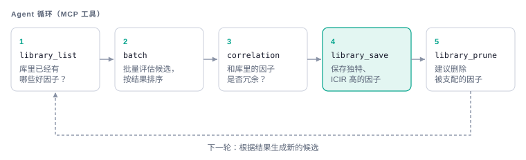

# MCP Server

服务现有 **34 个工具**，含 8 个 FactorDB 工具及 15 个后端发现、持久数据集、研究会话与实验工具。
使用流程与恢复语义见 [Agent 研究指南](agent-research.md)。

MCP server 将 Assay 的 evaluate→library 循环暴露为 Model Context Protocol 工具，供 LLM
agent 调用以驱动自主的 alpha 挖掘。基于高层的 **FastMCP** API 构建
（[`src/assay/mcp/server.py`](../../../src/assay/mcp/server.py)）。

## 运行

```bash
python -m assay.mcp.server                          # stdio (Claude Desktop / local agents)
python -m assay.cli serve-mcp --transport sse --port 8001   # SSE/HTTP (remote agents)
```

模块导入时不需要凭证；服务底层的数据存储是惰性构建的，因此
只有触及价格数据的工具才需要 MASSIVE 凭证。

## 评估与因子库工具（11 个）

| Tool | Purpose |
|---|---|
| `assay_evaluate` | 求值单个因子 → `FactorReport`（qlib 或 Python 语法） |
| `assay_batch` | 并行求值多个因子，按 `rank_icir` 排序（优先于循环使用） |
| `assay_lint` | 无需数据的表达式语法检查（方言、字段、算子、诊断） |
| `assay_universes` | 列出可用股票池及其代码数量与默认值 |
| `assay_portfolio_backtest` | 对因子做完整组合回测 → 精简的 `PortfolioReport` |
| `assay_library_list` | 列出库中因子并支持过滤（生成前检查冗余） |
| `assay_library_get` | 获取单个因子的完整 `FactorReport` |
| `assay_library_save` | 将报告保存到库 |
| `assay_library_correlation` | 因子 ID 之间的两两相关性 |
| `assay_library_prune` | 识别 / 移除冗余因子 |
| `assay_system_status` | 数据新鲜度 + 缓存统计 |

`assay_evaluate` 的描述在运行时会被实时的算子模式
（`assay.engine.operator_schema()`）丰富，因此 agent 能内联看到可用的算子。

## Claude Desktop 配置

`~/.config/claude/claude_desktop_config.json`：

```json
{
  "mcpServers": {
    "assay": {
      "command": "python",
      "args": ["-m", "assay.mcp.server"],
      "env": { "ASSAY_DATA_DIR": "data_2025_2026h1" }
    }
  }
}
```

## 典型的 agent 循环




设计契约：[architecture.md](../design/architecture.md) §6。
