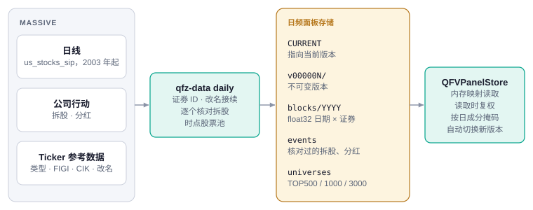

# 美股数据（QFinVerse）

在 assay.qfinverse.com 上，美股股票池读取 QFinVerse 用 MASSIVE 数据构建的日频面板：2003 年 9 月起的日线、拆股和分红，以及 MASSIVE 的 ticker 参考数据。这种部署下 Assay 自己不再导入美股数据。



## 配置

```bash
export ASSAY_QFV_PANEL_DIR=/srv/qfinverse/data/daily_panel   # 面板根目录（含 CURRENT）
assay serve-api
```

读取代码随 Assay 一起提供，在 `src/assay/data/qfv_panel`（格式 `qfv-daily-panel/1`），可用 `scripts/sync_qfv_panel.py` 从 QFinVerse 代码重新同步。QFinVerse 每个交易日纽约时间 21:45 更新面板；Assay 在下一次请求时切到新版本，旧版本的缓存结果不会复用。

## 股票池

| 股票池 | 成分 |
|---|---|
| `TOP500`、`TOP1000`、`TOP3000` | 每月第一个交易日流动性最好的普通股 |
| `SP500`、`NASDAQ100` | 带日期的指数成分历史，对应到 QFinVerse 证券 |

`TOP` 股票池按此前 63 个交易日的成交额中位数排序（至少交易 50 天，最近收盘价不低于 5 美元），排除 ETF、ADR、优先股、权证、单位和权利。只用生效日之前的数据，也保留后来退市的股票。

评估覆盖区间内任何时候属于股票池的证券，并且只在它属于股票池的日子里打分。如果只用最后一天的成分，会漏掉所有中途调出的股票；在 2016–2026 年的 NASDAQ100 上，这会让低波动和振幅类因子的 IC 符号反过来。

## 证券 ID

日线只有 ticker，所以每只证券有一个永久 ID：

- 一个 ticker 停止交易超过 63 个交易日后再出现，算新证券，老的那只标为 `TICKER~YYYY-MM`（如 `ABC~2004-03`）；
- 改名按同一只证券处理：MASSIVE 的 ticker 历史或相同的 composite FIGI（`FB` → `META`）；或者退市股和新股票同属一个 CIK，且价格连续在 25% 以内（`COH` → `TPR`）。

表达式或图表里的 ticker，指窗口最后一天持有该 ticker 的证券。

## 公司行动

价格按成交原样存储，读取时复权到窗口最后一天的股本口径，并且只用除权日在窗口之内的事件。所以结束在过去的回测读不到之后的拆股。

| 字段 | 含义 |
|---|---|
| `open high low close` | 拆股和分红复权（总收益口径） |
| `volume` | 拆股复权 |
| `transactions` | 原样 |
| `dvol` | 原始收盘价 × 成交量 |
| `ret` | 日总收益，与窗口无关 |

每次拆股使用前都用价格核对：

| 状态 | 含义 | 是否应用 |
|---|---|---|
| `ok` | 除权日价格按比例跳变 | 是 |
| `moved` | 跳变比供应商日期差几天，按实际跳变日处理 | 是 |
| `no_jump` | 前后 10 个交易日内没有跳变：价格已复权，或拆股并未发生 | 否 |
| `small` | 比例在 1:1 的 10% 以内（送股） | 是 |

分红按 `1 − 现金 / 前收` 复权。以下分红跳过：不是美元；超过股价一半（基本都是单位错误）；除息日前 15 天内没有收盘价。

## 速度

面板按年存成 float32 稠密矩阵，内存映射读取。2016–2026 年的 `TOP500` 约 0.3 秒读完，2010–2026 年的整个 `TOP3000` 约 3 秒。`SP500` 十年 6 个因子评估约 11 秒，原来按 ticker 存的 parquet 需要 54 秒。
