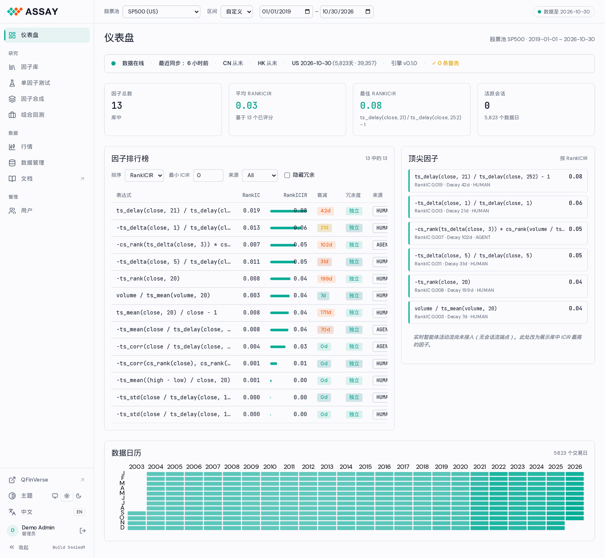
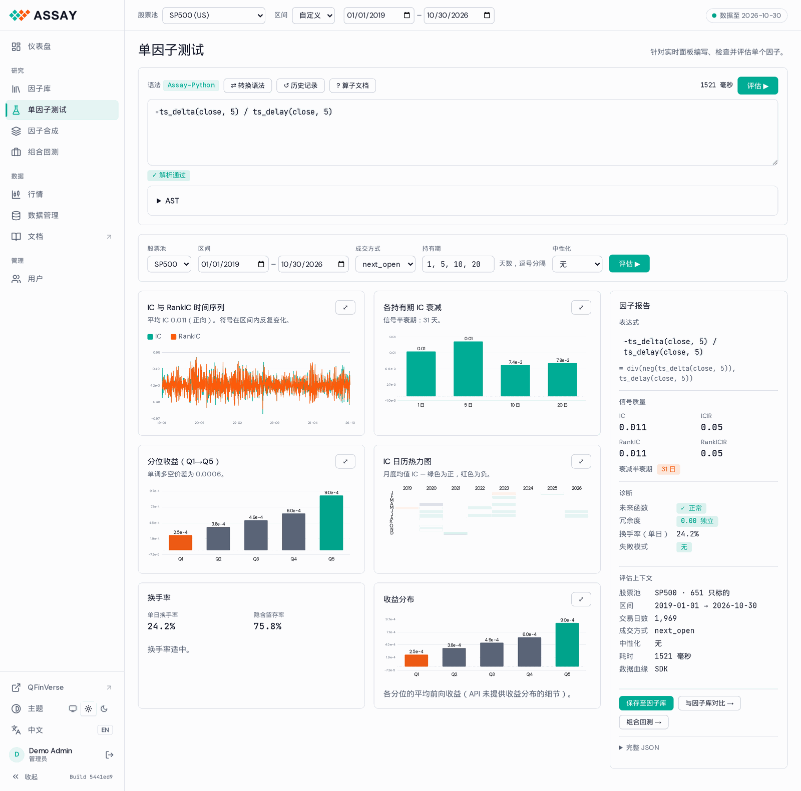
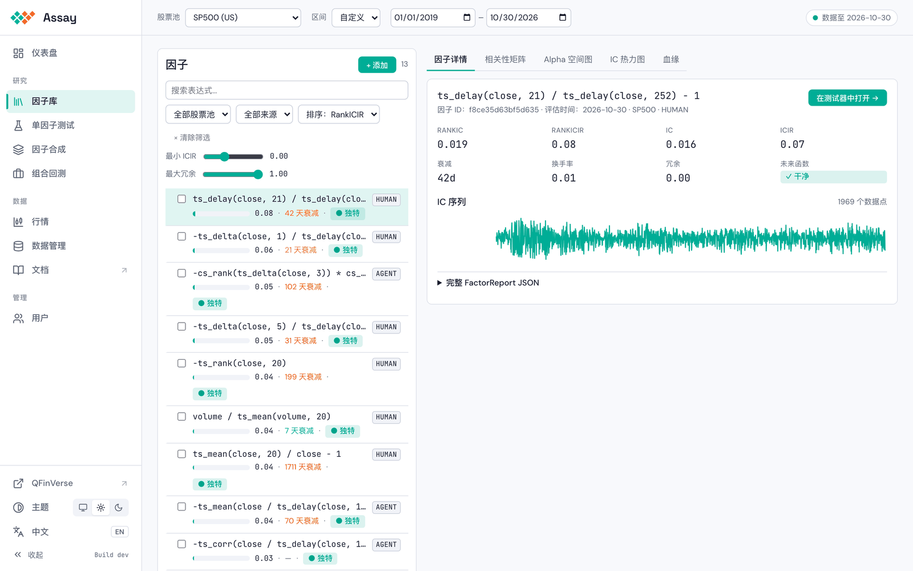
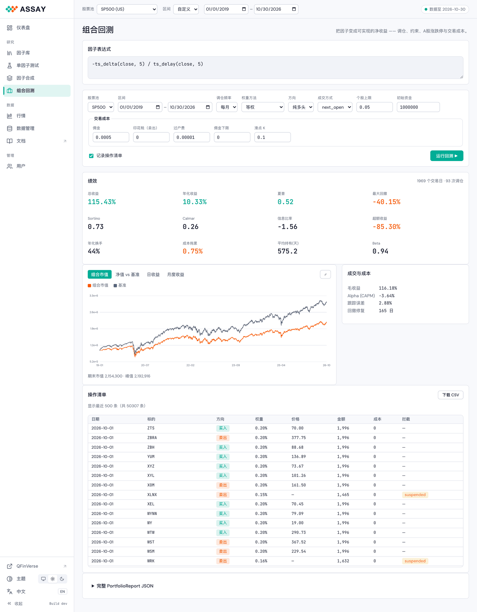
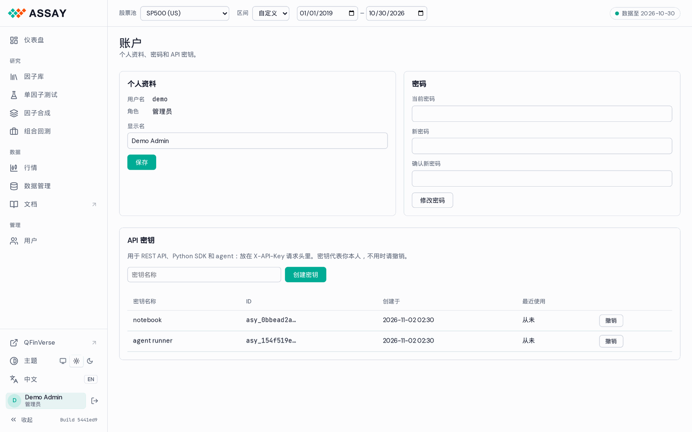
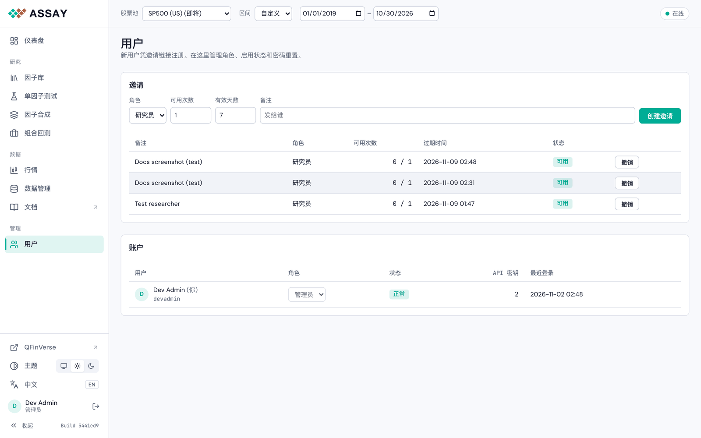

# WebUI

控制台由 API 服务直接提供，不需要安装，也不需要构建。代码在 [`src/assay/api/static/`](../../../src/assay/api/static/)，设计说明见 [WebUI 设计文档](../design/webui.md)。

```bash
python -m assay.cli serve-api --port 8000      # 然后打开 http://localhost:8000
```

在 assay.qfinverse.com 上需要先登录，见下文[账户](#账户)。

## 布局



- **侧栏。** 页面分三组（研究、数据、管理），下面依次是 QFinVerse、主题、语言、你的账户和「收起」。「文档」在新标签页打开 Doc Hub。最底下一行显示当前运行的 Build。
- **上下文栏。** 股票池和区间对所有页面生效。右侧的标签显示数据截至哪天；黄色或红色表示数据陈旧或连不上。
- 主题（跟随系统、浅色、深色）与 QFinVerse 共用，切换后图表会重新绘制。

## 页面

**仪表盘。** 数据状态、四张指标卡、因子排行榜（排序、最低 ICIR、来源、隐藏冗余）、顶尖因子，以及有数据的交易日日历。

**单因子测试。** 用 qlib 或 Python 语法写表达式，输入时实时检查，语法树点一下就能展开。点「评估」（或 Cmd/Ctrl+Enter）后结果逐项出来：IC 与 RankIC 时间序列、各持有期的衰减、分组收益、按月 IC、换手，以及带改进建议的汇总。「保存」把报告存进因子库；「组合回测」用同一个因子进入下一步。



**因子库。** 所有保存的因子，可搜索、筛选。标签页：因子详情、相关性矩阵（含剪枝预览）、Alpha 空间图、IC 热力图、血缘。



**因子合成。** 选几个因子和合成方法（等权、IC 加权，装了相应库时还有线性和树模型），在训练、验证、测试三段上给合成因子打分。结果可以保存，之后再载入。

**组合回测。** 把因子变成多头或多空组合，设置调仓、权重、限制和成本，输出净值、夏普、回撤、换手和成本拖累。



**行情。** 单只股票的日线，可选复权方式，并能叠加因子值。

**数据管理**（管理员）。数据源、导入任务、定时任务和缓存。如果服务器从 QFinVerse 读美股数据，美股不需要在这里跑任务。

## 账户

服务器开启账户时（`ASSAY_ACCOUNTS=1`，assay.qfinverse.com 就是这样）：

- **凭邀请注册。** 打开管理员发来的链接，设置用户名和至少 10 位的密码。
- **账户**（点侧栏里自己的名字）：修改显示名和密码，管理 API 密钥。新密钥只显示一次；脚本和 agent 把它放在 `X-API-Key` 请求头里。
- **用户**（管理员）：创建邀请（角色、可用次数、有效天数），修改角色，停用或删除账户，生成一次性的密码重置链接。





## 提示

- 评估需要整个窗口都有数据：20 日的因子在第一个日期之前要有 20 天历史，否则结果为空，并给出 `ALL_NAN` 诊断。
- 部署新版本后刷新页面即可用上新 Build（每次加载都会重新校验静态资源）。
- 仪表盘上的实时 agent 信息流还没接入，右栏暂时显示顶尖因子。
