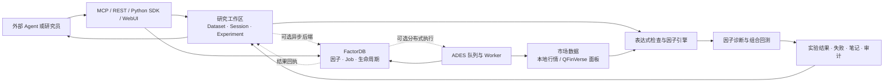

# Assay 项目总览

本文梳理 2026-11-13 的项目状态。**“当前源码”指本地工作树，包含尚未提交的修改；“线上”指已部署的版本。** 两者的功能并不完全相同。本文是状态索引，具体参数与操作以对应指南和实际接口为准。

## 定位与边界

Assay 是面向外部 Agent 的因子研究环境：它同时提供因子计算与组合回测、可持续的研究记录、因子生命周期管理，以及供 Agent 调用的接口。它不内置必须使用的模型或固定的挖掘策略，提出假设、决定下一次实验和解释结果仍由外部 Agent 或研究员负责。

QFinVerse 可以为 Assay 提供日频市场面板；Assay 也支持自己的数据管线和其他评估后端。AlphaBench 是独立的评测项目，已有适配器可连接它的服务；RD-Agent 等则可作为 Agent 策略或比较对象。它们不等同于 Assay 本身。

## 数据和研究流程

典型流程是：注册数据集配置 → 创建或恢复研究会话 → Agent 查看上下文并提交假设与表达式 → 引擎计算因子、诊断并按配置运行组合回测 → 保存成功或失败、候选决定和笔记 → Agent 检查并选择下一步，最终导出或审计记录。默认研究后端在进程内执行；只有选择 `factordb_ades` 后端时，研究实验才通过 FactorDB/ADES 异步执行。直接提交 FactorDB job 也不会自动创建研究 session。

## 主要模块

| 模块 | 当前源码提供的能力 | 主要位置 |
|---|---|---|
| 数据层 | 美股、A 股、港股数据管线及 QFinVerse 日频面板读取；日期、股票池、复权及行情面板处理 | `src/assay/data/`， [数据与复权](guide/data-and-adjustment.md) |
| 因子引擎 | 表达式解析、算子与 AST、面板计算、预计算和缓存；支持部分 qlib 风格表达式 | `src/assay/engine/`， [架构](design/architecture.md) |
| 因子评估与组合回测 | IC、RankIC、衰减等诊断，以及调仓、成本、约束、净值和交易记录 | `src/assay/evaluator/`、`src/assay/portfolio/`， [组合回测](guide/portfolio-backtest.md) |
| 持续研究状态 | 数据集配置、会话、预算、假设、失败、实验关系、候选决定、笔记、导入导出 | `src/assay/research*.py`， [Agent 研究](guide/agent-research.md) |
| FactorDB | 规范因子身份、去重、评分、相似度、查询和批量 job；关联研究实验和候选历史 | `src/assay/factordb/`， [FactorDB 设计](design/factordb.md) |
| ADES | 为 FactorDB 可选地分发计算切片，管理 worker、租约、心跳、重试及结果回执 | `src/assay/ades/`， [Agent 研究](guide/agent-research.md) |
| 审计 | 检查研究记录中的预算、来源、生命周期与指标证据，生成供人工或 Agent judge 阅读的报告 | `src/assay/research_audit.py`， [研究审计](guide/research-audit.md) |
| 接入与管理 | Python SDK、CLI、REST、MCP、WebUI、账户和文档中心 | `src/assay/api/`、`src/assay/mcp/`， [部署](guide/deployment.md) |

研究 experiment、FactorDB job、已保存的因子库条目各自承担不同职责，并非同一条记录。研究 session 持久保存实验历史；计算用的临时 panel session 是进程内缓存，重启后需重新创建。

## 接口

| 用途 | 地址或方式 |
|---|---|
| 网站 | [assay.qfinverse.com](https://assay.qfinverse.com/) |
| MCP | `https://assay.qfinverse.com/mcp/`；本地也支持 stdio |
| REST | `https://assay.qfinverse.com/v1/`；研究、因子、组合、FactorDB 和 ADES 有各自路由 |
| 接口文档与发现 | `/docs`、`/openapi.json`、`/.well-known/assay.json`、`/doc/` |
| Python / CLI | `assay` Python 包及 `assay` 命令，详见 [Python SDK](guide/python-sdk.md) 和 [CLI](guide/cli.md) |

2026-11-13 的线上发现文档报告 40 个 MCP 工具、需要 Bearer 或 API key，且当时不提供 OAuth。实际工具及其 schema 以目标服务的发现文档或 MCP `tools/list` 为准。Assay 服务端不要求模型 API key；调用方自行配置模型和凭据。

## 关键能力的当前状态

- **回测可靠性**：组合回测覆盖成本、最低佣金、资金、次日开盘／收盘执行和记录审计。历史组合数据集的兼容修复已上线；没有新执行协议标识的旧 `next_close` 数据集仍需按新版约定重新注册，历史报告可读。数据正确性仍取决于行情来源、股票池和执行假设。
- **容量与市场冲击（本地）**：设置初始资金后，新配置可用此前交易日的未复权收盘价与成交量估算成交额及订单参与率，再按配置限制容量和计算冲击；数据不足时阻断受影响订单。A 股需要确认成交量单位。未提供本金或参与率、显式关闭模型、或使用强制成交时有相应限制。详见 [Agent 研究](guide/agent-research.md)；此功能尚未部署到当前线上版本。
- **生命周期**：研究会话保存多次实验及决定；FactorDB 保存规范因子、规格、job 和计算结果。二者可关联，Agent 可继续研究并导出或导入记录。
- **幂等性（本地）**：研究实验支持稳定 `request_id`。普通 FactorDB 提交在 ADES 模式下也可使用 `request_id`；客户端重试须复用相同 ID 和输入，跨 REST/MCP 重试可返回同一任务。未提供 ID 的提交不具备这项保证，非 ADES 的普通 FactorDB 提交尚不支持该参数。
- **账户隔离（本地）**：启用账户认证后，个人账户使用独立研究、因子库、组合及 FactorDB 注册数据；服务密钥仍访问共享工作区。行情、ADES 队列和可信 worker 等资源仍共享，账户级 CPU、内存、存储硬配额尚未实现。升级前需备份账户与工作区，用户需重新登录；历史共享数据不会自动划归个人。当前线上发现文档仍标记为共享研究工作区。
- **复现与审计**：数据集哈希固定配置，并不自动冻结供应商行情、后端代码或模型；清单哈希可检查记录完整性，但不是真实性证明，也不自动重跑实验。

## 验证

项目提供自动化测试和[性能测试命令](guide/performance.md)。运行结果取决于测试版本、数据与环境；组件级测试不能直接推断完整系统的效率。

## 版本与后续工作

2026-11-13 的只读健康检查显示，线上构建为 `03bab24`，其研究工作区是共享的。仓库中的后续能力需要部署后才能在线上使用。发布前应完成回归、备份、账户迁移与重新登录提示，并对 REST、MCP、行情及 worker 进行线上验收。

接下来优先处理：完善并验收账户级资源隔离；核对尚未发布的改动及历史数据迁移；按最终版本补充系统级效率和用户工作流证据。当前项目已经具备 Agent 调用、持久状态、闭环实验与审计的主要结构，但不能将已有工程能力直接表述为完整生产隔离或已证明的全面性能优势。
