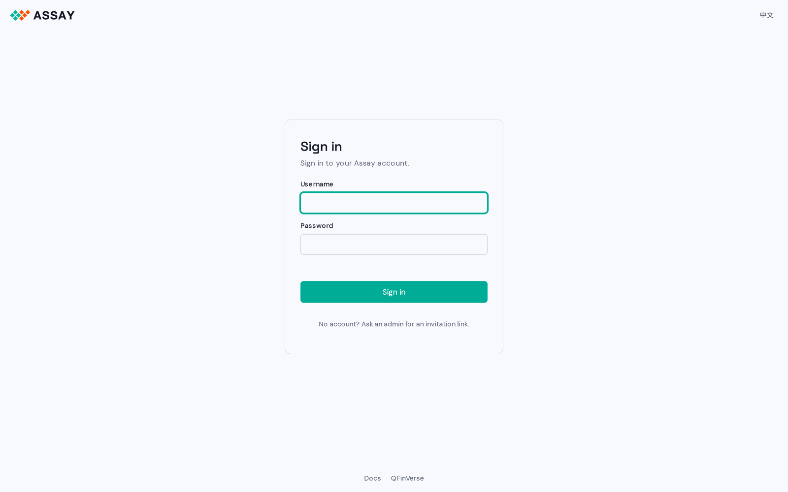
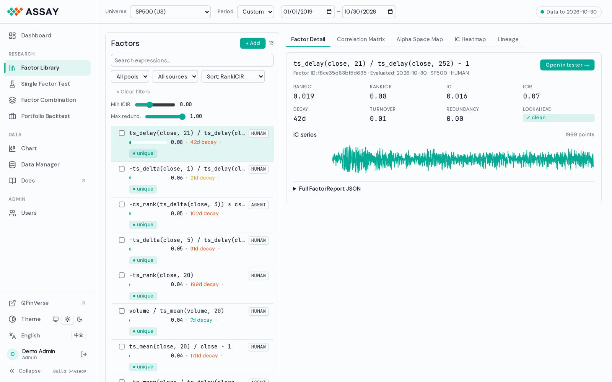
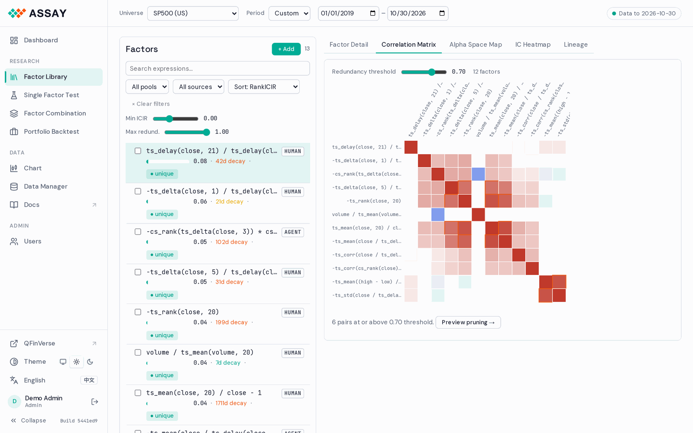
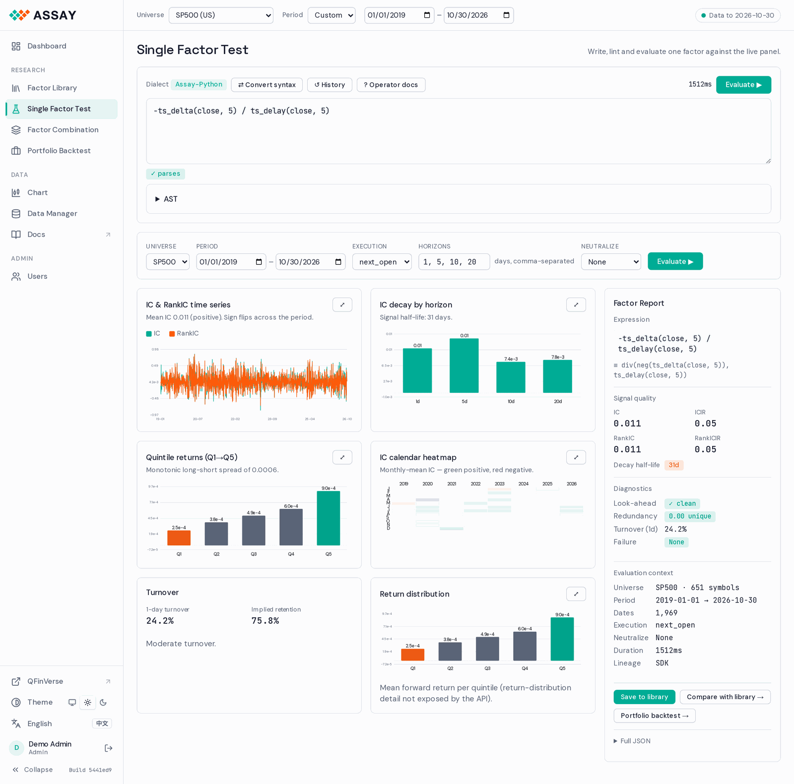

# Assay WebUI — Detailed Design

**Version:** 0.2 · 2026-11  
**Scope:** every page of the shipped console  
**Stack (shipped):** vanilla JS modules and hand-drawn SVG charts, no build step — [`src/assay/api/static/`](../../../src/assay/api/static/)

> **Status (2026-11).** The console that ships is the zero-build app served by FastAPI. It
> covers Dashboard, Factor Library (detail, correlation matrix, alpha-space map, IC heatmap,
> lineage), Single Factor Test, Factor Combination, Portfolio Backtest, Chart, Data Manager,
> Account and Users, in the QFinVerse look (sidebar, light and dark, EN / 中文), with
> invite-only accounts when `ASSAY_ACCOUNTS=1`. The screenshots in this document are of
> that app.
>
> Sections 6–10 (React components, stores, hooks, Monaco) describe the React rebuild that
> was planned first. They stay as a reference for component behaviour; they are not the
> shipped code.
>
> - Universes: TOP500 / TOP1000 / TOP3000, SP500 and NASDAQ100 on QFinVerse data; CSI300 /
>   500 / 1000 and HK100 where Tushare data is ingested.
> - The US day bars carry OHLCV and trade count; there is no `vwap` field.
> - Not wired: the live agent feed on the Dashboard (no session-stream endpoint yet).
> - Diagnostic codes and `failure_mode` values come from `assay.engine.diagnostics`
>   (`SYNTAX_ERROR` · `LOOKAHEAD` · `CONSTANT` · `ALL_NAN` · `RUNTIME_ERROR`; codes
>   `ASSAY-P###/E###/O###`).

---

## Table of Contents

1. [Information Architecture](#1-information-architecture)
2. [Global Shell](#2-global-shell)
3. [Dashboard](#3-dashboard)
4. [Factor Library Analysis](#4-factor-library-analysis)
5. [Single Factor Test](#5-single-factor-test)
6. [Shared Components](#6-shared-components)
7. [State Management](#7-state-management)
8. [Data Fetching & Streaming](#8-data-fetching--streaming)
9. [Monaco Editor Extension](#9-monaco-editor-extension)
10. [Routing](#10-routing)
11. [Design Tokens](#11-design-tokens)

---

## 1. Information Architecture

```
#/dashboard            Dashboard
#/library              Factor Library (tabs: detail, matrix, alpha space, IC heatmap, lineage)
#/factor               Single Factor Test (blank editor)
#/factor/:factor_id    Single Factor Test (pre-loaded)
#/combination          Factor Combination
#/portfolio            Portfolio Backtest (#/portfolio/:factor_id pre-loaded)
#/chart                Chart
#/data                 Data Manager (admins)
#/account              Account: profile, password, API keys
#/users                Users and invitations (admins)
/login                 Sign in, invitation sign-up, password reset, first-admin setup
/doc/                  Doc Hub (separate page)
```

URL params shared across all routes (global state, synced to URL):

```
?universe=NASDAQ100
&period_start=2020-01-01
&period_end=2024-12-31
```

---

## 2. Global Shell

")

### 2.1  Layout

A sidebar on the left and the page on the right, as in the QFinVerse console. A sticky
context bar sits on top of every page. Pages scroll; the sidebar and the context bar stay.

### 2.2  Sidebar

224 px wide; *Collapse* folds it to 60 px of icons (remembered per browser).

| Element | Behaviour |
|---|---|
| QFinVerse mark + "Assay" | Goes to the Dashboard |
| Dashboard | Top link |
| Research | Factor Library · Single Factor Test · Factor Combination · Portfolio Backtest |
| Data | Chart · Data Manager (admins) · Docs (opens the Doc Hub in a new tab) |
| Admin | Users (admins only) |
| QFinVerse | Opens the QFinVerse console in a new tab |
| Theme | System / light / dark; shared with QFinVerse (`qfv-theme`) |
| Language | English / 中文 |
| User row | Name and role; opens Account. The icon beside it signs out |
| Build | `Build <commit>` of the running deployment; the tooltip adds engine version and deploy time |

The active page is marked with a tinted row and a 3 px accent bar.

### 2.3  Context bar

| Element | Behaviour |
|---|---|
| Universe | Universes with data are selectable; others are listed as coming soon |
| Period | 1Y / 3Y / 5Y presets or a custom start and end date |
| Status pill | "Data to <last date>"; green when fresh, amber when stale or degraded, red when unreachable. Click goes to the Dashboard |

Universe and period are global: they are kept in the URL and the browser, and every page
reads them. Changing them does not re-run an evaluation that is already running.

### 2.4  Sign-in

With accounts on, a signed-out visitor is sent to `/login` and comes back to the same page
afterwards. The same page handles invitation sign-up (`?invite=`), password reset
(`?reset=`) and, on a new server, creating the first admin.



---

## 3. Dashboard

### 3.1  Page layout

The page is shown in the screenshot in §2.

### 3.2  StatusBar

A slim strip at the top of the Dashboard page: data status, last sync, per-market coverage, engine version and data warnings.

- Green dot = fully synced, amber = stale, red = error
- Click "2 warnings" expands an inline alert panel listing specific data quality issues
- The bar is sticky within the Dashboard page scroll container

### 3.3  KPI Row

Four cards of equal width: total factors in the library, average RankICIR, best RankICIR
(with its expression) and active sessions (with the number of data days). Labels are small
uppercase muted text; the value is in the mono face.

### 3.4  Factor Leaderboard

Left column (60%), shows the top 100 factors sorted by RankICIR.

#### Controls (above table)

- Sort dropdown: RankICIR (default), IC, Decay half-life, Evaluated date
- Min ICIR filter: slider + numeric input, 0.0–2.0
- Source filter: All, AGENT, HUMAN, WQ101, IMPORTED
- Hide redundant toggle: filters out factors with `redundancy_score > 0.7`

#### Table columns

| Column | Source field | Width | Behaviour |
|---|---|---|---|
| Expression | `expr` (truncated to 40 chars) | flex | Tooltip shows full expression on hover |
| RankIC | `rank_ic` | 72px | Right-aligned, 3 decimal places |
| RankICIR | `rank_icir` | 80px | Right-aligned, inline bar overlay |
| Decay | `decay_halflife_days` | 64px | `Xd` format, color: green < 10d, amber 10–30d, red > 30d |
| Redundancy | `redundancy_score` | 72px | Colored badge: green < 0.4, amber 0.4–0.7, red > 0.7 |
| Source | `lineage.source` | 80px | Small tag badge |
| Status | `failure_mode` | 64px | Green check or red `!` badge |

Table behaviours:
- Click any row → navigates to `/factor/:factor_id` with factor pre-loaded
- Hover any row → shows a mini preview popover with IC sparkline (last 60 days)
- Table is virtualised (react-virtual) for performance with 1000+ rows
- Sticky header

### 3.5  Agent Activity Feed

Right column (40%). Live feed of factor evaluations triggered in the current or most recent agent session.

#### Session summary panel (top of feed)

> Not wired yet: there is no session-stream endpoint. The right column shows the library's top factors by RankICIR instead (see §2). The rest of this section is the target.

#### Feed entries

Each entry is a card with:

- New entries animate in from the top (CSS slide-down transition)
- Maximum 50 visible entries; older ones fade out at the bottom
- Failed evaluations shown with red left border and the `failure_mode` code
- Click any entry → navigates to `/factor/:factor_id`
- A "Pause feed" toggle freezes auto-scroll so the user can read

Polling: new entries via SSE subscription to `GET /v1/events/session-stream`.

### 3.6  Data Calendar

Full-width strip below the leaderboard + feed row. A GitHub contribution heatmap showing data availability by trading day.

Cell colors:
- Dark green: 100% coverage (all symbols have data)
- Medium green: > 95% coverage
- Amber: 80–95% coverage
- Red: < 80% coverage
- Light gray: non-trading day (weekend / holiday)

Interactions:
- Hover cell → tooltip: `Dec 15 2024  101/101 symbols  Last sync: 21:05 UTC`
- Click red/amber cell → expands an inline data quality panel below the calendar listing missing symbols
- Year labels on left are clickable to scroll to that year

---

## 4. Factor Library Analysis

### 4.1  Page layout



The left/right split is resizable — user can drag the divider between 25%–50%.

### 4.2  Mode tabs

Five tabs: Factor detail, Correlation matrix, Alpha space map, IC heatmap, Lineage.

Mode state is persisted in the URL as `?mode=matrix`.

### 4.3  Factor List (left panel)

#### Filter bar

- Full-text search runs against the expression string (client-side for small libraries, server-side for > 500 factors)
- Sliders update results on release (not on drag, to avoid excessive API calls)
- Active filter count badge on "Clear filters" button

#### List item

- Checkbox for multi-select
- Expression in monospace, truncated, full text in tooltip
- ICIR as a horizontal bar (filled proportion = ICIR / 2.0, max scale)
- Decay half-life
- Redundancy badge: `● unique` (green), `◐ similar` (amber), `● redundant` (red)
- Source tag: `AGENT`, `HUMAN`, `WQ101`, `IMPORTED`
- Clicking the item body: selects it and updates the right panel
- Clicking the checkbox: adds to multi-select without changing right panel

Selected item has a blue left border. Active item (last clicked) has a slightly darker background.

#### Bulk action bar (appears when ≥ 1 item checked)

- Export: downloads FactorReport JSON or CSV for selected factors
- Tag: dropdown to add a label (create new or choose existing)
- Compare: switches to Correlation Matrix mode pre-seeded with selected factors
- Delete: shows confirmation modal listing expressions; confirmed deletion calls `DELETE /v1/library/factors`

### 4.4  Mode A — Factor Detail

Default mode. Shows when a factor is selected from the list.

Right panel layout:

The detail panel is shown in the screenshot in §4.1.

The "Open in tester →" button navigates to `/factor/abc123`.

### 4.5  Mode B — Correlation Matrix

Full right panel is a heatmap.



Heatmap:
- Rows and columns are factor expressions (truncated)
- Cell color: diverging scale, red = high positive correlation, white = 0, blue = high negative
- Threshold overlay: cells above the slider value get a red diagonal strikethrough
- Factors are reordered by hierarchical clustering when "Cluster" is on (computed client-side with hclust from `ml-hclust` library)
- Hover any cell: tooltip shows `ts_corr... × cs_rank...  correlation: 0.83`
- Click any cell: opens a scatter plot modal of the two factors' daily values

Summary below heatmap:

"Preview pruning" opens a side drawer listing the 8 factors that would be removed, keeping the one with higher RankICIR in each pair.

### 4.6  Mode C — Alpha Space Map

Full right panel is a 2D scatter plot.

The position of each point is computed by running UMAP on the pairwise rank-correlation distance matrix (1 - |corr|). Factors that behave similarly cluster together; orthogonal factors are far apart.

Plot:
- Each point is a factor
- Default: color = RankICIR (green → yellow → red scale), size = fixed
- "Color by" options: RankICIR, source (AGENT/HUMAN/WQ101), decay half-life, redundancy
- Hover: tooltip with expression, RankICIR, decay
- Click: selects factor, switches left panel to that factor, shows detail in Mode A panel simultaneously if split view is active
- "Show gaps" overlay: draws the convex hull of existing points and highlights the empty interior regions — these are unexplored alpha regions the agent should target
- Pan and zoom supported (d3-zoom)

UMAP is computed client-side using `umap-js` on page load or when the factor set changes. For > 300 factors a loading spinner appears (typically 1–3 seconds).

### 4.7  Mode D — IC Heatmap

Full right panel. A matrix where rows = factors, columns = trading dates, cells = IC value that day.

- Rows are factors in the same order as the left panel list (honors current filters)
- Columns are trading days, grouped by month
- Color: green for positive IC, red for negative, white for ~0
- Color scale slider sets the saturation anchor (default ±0.15 = full red/green)
- Hover cell: `Factor: ts_corr(close,volume,20)  Date: Nov 15 2024  IC: 0.061`
- Click row label: selects factor in left panel, shows detail in Mode A

This view makes regime effects immediately visible — a vertical band of red means all factors failed on those dates (market event). A horizontal band of red means one factor consistently fails.

### 4.8  Mode E — Factor Lineage

A directed graph showing the provenance of factors.

Nodes:
- `[PROMPT]` — LLM prompt (shows model, timestamp, prompt hash)
- `[FACTOR]` — factor expression (shows expression, RankICIR)
- `[SNAPSHOT]` — data snapshot used for evaluation

Edges:
- `[PROMPT] → [FACTOR]` — "generated"
- `[FACTOR] + [SNAPSHOT] → [FACTOR]` — "evaluated on"

Layout: top-to-bottom DAG using dagre layout algorithm.

Interactions:
- Hover node: tooltip with full details
- Click `[FACTOR]` node: selects in left panel, shows detail in Mode A
- Click `[PROMPT]` node: opens modal with full prompt text
- Double-click `[SNAPSHOT]` node: opens data calendar filtered to that snapshot date

---

## 5. Single Factor Test

### 5.1  Page layout



On narrow screens (< 1200px) the summary panel moves below the results grid and the results grid becomes 1 column.

### 5.2  Expression Editor

A Monaco Editor instance occupying approximately 180px height (4–6 lines). Resizable by dragging the bottom edge.

#### Toolbar above the editor

- Syntax toggle: shows which syntax is currently active; clicking switches highlighting mode
- Convert syntax: rewrites the current expression between qlib and Python syntax (calls the `syntax-bridge` utility in-process, no API call)
- Evaluate button: triggers evaluation; shows loading spinner after click, replaced by latency badge on completion (e.g. `342ms`)
- History: dropdown of last 20 evaluated expressions, click to restore
- Operator docs: opens a drawer with the full `OPERATOR_SCHEMA` as a searchable reference

#### Editor behaviours

- Default height: 4 lines (expands to content up to 8 lines before scrolling)
- Keyboard shortcut: `Cmd+Enter` (Mac) / `Ctrl+Enter` (Windows) triggers evaluation
- On load with `factor_id` route param: editor is pre-populated with the factor's expression
- Syntax error underlines appear as the user types, sourced from the parser running in a Web Worker
- The AST tree is rendered in a collapsible panel directly below the editor, hidden by default; the "AST" disclosure link toggles it

#### AST disclosure panel

Rendered as an indented tree. Node types use different colors: FieldNode (teal), LitNode (amber), OpNode (blue), BinOp (gray).

### 5.3  Config Row

A horizontal strip below the editor with six controls. Controls are compact (height 36px).

| Control | Options | Notes |
|---|---|---|
| Universe | Inherited from global state; shows current value; overridable per-evaluation | Changing here does not update global state |
| Period | Inherited from global state; overridable | Same as above |
| Execution | `next_open` (default), `next_close` | Tooltip explains each. `vwap` is disabled — the MASSIVE day-aggregate source has no intraday/VWAP data |
| Horizons | Multi-checkbox: 1d, 5d, 10d, 20d (all default) | Affects decay curve range |
| Neutralize | None (default), Sector, Industry, Market cap | Applies `cs_neutralize` before IC |
| Evaluate button | Primary CTA, also triggered by `Cmd+Enter` | Latency badge replaces spinner on complete |

When universe or period differ from global state, the control shows a small `*` indicator and a tooltip: "This evaluation uses a different universe/period than your global setting."

### 5.4  Results Grid

Six chart cards in a 2×3 grid. Chart cards share a common card shell:

- Title: 14px, medium weight
- Interpretation hint: 12px muted text, one line, updates based on results
- `↓` download icon: exports chart data as CSV
- Chart area fills remaining space; minimum height 220px

Charts render progressively — each card shows a loading skeleton until its data arrives via SSE.

#### Card 1 — IC & RankIC Time Series

**Chart type:** Line chart (Recharts `LineChart`)

**Data:** `ic[]`, `rank_ic[]`, `dates[]` from `eval.ic_series` SSE event

**Series:**
- IC: blue line, thin (1.5px)
- RankIC: teal line, thin (1.5px)
- Rolling 63-day mean IC: blue thick line (3px)
- ±0.02 significance band: light gray filled area

**Axes:**
- X: trading date, monthly ticks, abbreviated month labels
- Y: [-0.15, 0.15] default range; auto-scales if values exceed

**Annotations:**
- Vertical dashed lines at major market events (COVID crash Mar 2020, Fed rate hikes 2022); toggled via a "Show events" checkbox
- Summary stats in card header: `IC: 0.032  ICIR: 0.43  RankIC: 0.047  RankICIR: 0.61`

**Interpretation hint:** `"Consistent positive signal. IC is stable across the period."`  / `"Unstable IC — signal reverses in bear markets."`

#### Card 2 — Decay Curve

**Chart type:** Bar chart (Recharts `BarChart`)

**Data:** `ic_by_horizon`, `halflife` from `eval.decay` SSE event

**Bars:**
- One bar per horizon (1d, 5d, 10d, 20d)
- Bar height = RankIC at that horizon
- Error bars (thin lines) show ±1 std of daily IC at each horizon

**Overlaid line:**
- Exponential decay fit: dashed line through bar tops
- Half-life annotation: callout label pointing to the 50% IC level

**Interpretation hint:** `"Signal half-life: 12 days. Suitable for weekly rebalancing."`

#### Card 3 — Group Return Analysis

**Chart type:** Bar chart with optional line overlay

**Data:** `quintile_returns` from `eval.groups` SSE event

**Bars:**
- 5 bars, one per quintile (Q1 = short, Q5 = long)
- Color: Q1 red, Q2–Q4 gray, Q5 green
- Value labels above each bar (e.g. `-0.12%`, `+0.15%`)

**Controls above chart:**
- Return type toggle: `Raw` / `Market-adjusted` / `Sector-adjusted`
- Horizon selector (1d, 5d, 10d, 20d) — updates chart on change

**Overlaid line:** Long-short spread (Q5 − Q1), shown on secondary Y axis

**Interpretation hint:** `"Monotonic spread of 0.27%/day long-short. Strong signal."` / `"Non-monotonic — Q3 outperforms Q5. Factor may be non-linear."`

#### Card 4 — Factor Heatmap

**Chart type:** Custom SVG calendar heatmap

**Data:** `ic[]`, `dates[]` from `eval.ic_series` SSE event (same data as Card 1)

**Layout:**
- Columns: trading days, one cell per day, 4px wide
- Rows: one row per year
- Month labels at top; year labels at left
- Cell color: green (positive IC) → white (zero) → red (negative IC), symmetric diverging scale

**Interactions:**
- Hover cell: tooltip `Dec 15 2024  IC: 0.061`
- Color scale adjustable via a small slider below the chart (default ±0.10)

**Interpretation hint:** `"Strong in 2021–2022. Signal weakens post-2023 rate hikes."`

#### Card 5 — Turnover Analysis

**Chart type:** Dual-axis line chart

**Data:** Computed from `factor_vals` (rank autocorrelation) and cost model

**Series:**
- Primary Y axis: 63-day rolling rank autocorrelation (blue line)
- Secondary Y axis: estimated net IC after transaction costs (orange dashed line)

**Reference line:** Horizontal line at `autocorr = 0.8` (typical "low turnover" threshold)

**Summary below chart:**
```
Avg autocorrelation: 0.83  ·  Estimated cost drag: 0.008 IC  ·  Net IC: 0.039
```

**Interpretation hint:** `"Low turnover factor. Transaction costs consume ~17% of gross IC."`

#### Card 6 — Return Distribution

**Chart type:** Overlaid histogram (Recharts `BarChart` with two data series)

**Data:** Forward return distributions for Q1 (short) and Q5 (long) quintiles

**Series:**
- Q5 (long) returns: green bars, 40% opacity
- Q1 (short) returns: red bars, 40% opacity
- KDE smooth lines overlaid on each histogram (computed via `kernel-density-estimator` utility)

**Stats panel below chart:**
```
                 Q5 (Long)    Q1 (Short)
Mean return:     +0.0015      -0.0012
Std dev:          0.0089       0.0091
t-statistic:     2.34  (p < 0.02)
```

**Interpretation hint:** `"Distributions well-separated. Long-short return is statistically significant."`

### 5.5  Summary Panel

Fixed 300px right column. Shows the structured FactorReport.

#### Loading state

While evaluation is in progress: shows a loading skeleton for each section.

#### Populated state

- "Save to library" button: calls `POST /v1/library/factors`, shows success toast
- "Compare with library →" button: navigates to `/library?mode=matrix` with this factor pre-seeded in the correlation matrix against the top 20 library factors by RankICIR
- "Full JSON" disclosure: expands a `<pre>` block with the complete `FactorReport` JSON, syntax-highlighted, with a copy button

#### Error state (when `failure_mode` is set)

Rendered from the engine's `FactorDiagnostics` (the `errors[]` / `warnings[]` arrays of
`diagnose().to_dict()`). The header is the diagnostic `title`, the code badge is the stable
`ASSAY-*` id, the body is the `message` + caret `snippet`, and the fix line is the
`suggestion`. Example — a real `LOOKAHEAD_SHIFT` (`failure_mode: LOOKAHEAD`):

`failure_mode` is one of `SYNTAX_ERROR` · `LOOKAHEAD` · `CONSTANT` · `ALL_NAN` ·
`RUNTIME_ERROR`; parse errors (`ASSAY-P###`) surface inline in the editor (§9) as well.
The error state replaces the entire summary panel content. The charts still render with
whatever partial data is available before the error was detected.

---

## 6. Shared Components

### 6.1  `<FactorReportCard />`

Compact card used in the leaderboard and agent feed. Accepts a `FactorSummary` or `FactorReport` prop.

```typescript
interface FactorReportCardProps {
  factor:    FactorSummary | FactorReport
  compact?:  boolean          // true = no sparkline, 1 line height
  onClick?:  () => void
  selected?: boolean
}
```

### 6.2  `<ICSparkline />`

A minimal 60-day IC sparkline. Used in the leaderboard hover preview and factor detail card.

```typescript
interface ICSparklineProps {
  ic:        number[]   // last 60 values
  width?:    number     // default 120
  height?:   number     // default 32
  color?:    string     // default: blue if mean > 0, red if mean < 0
}
```

### 6.3  `<RedundancyBadge />`

```typescript
interface RedundancyBadgeProps {
  score:          number          // 0.0–1.0
  nearestFactor?: FactorSummary  // shown in tooltip if redundant
}
// Renders: "● unique" (score < 0.4), "◐ similar" (0.4–0.7), "● redundant" (> 0.7)
```

### 6.4  `<ExpressionTag />`

A monospace pill displaying a truncated factor expression. Full expression shown in tooltip on hover.

```typescript
interface ExpressionTagProps {
  expr:      string
  maxChars?: number    // default 40
  onClick?:  () => void
}
```

### 6.5  `<FactorReportJSON />`

Syntax-highlighted JSON display with copy button and line count badge.

```typescript
interface FactorReportJSONProps {
  report:  FactorReport
  maxHeight?: number    // default 400, scroll if taller
}
```

### 6.6  `<SkeletonChart />`

Animated loading skeleton sized to match a chart card. Used while SSE events are pending.

```typescript
interface SkeletonChartProps {
  height?:  number  // default 220
  type?:    "line" | "bar" | "heatmap"  // affects skeleton shape
}
```

---

## 7. State Management

All state is in Zustand stores. No Redux. No Context API for state (only for DI/config).

### 7.1  Global store

```typescript
// src/store/global.ts

interface GlobalState {
  // User-controlled global settings
  universe:         string               // "NASDAQ100"
  period:           [string, string]     // ["2020-01-01", "2024-12-31"]
  sessionId:        string | null        // created after universe/period set
  sessionSetupMs:   number | null        // how long session creation took

  // Actions
  setUniverse:      (u: string) => void
  setPeriod:        (p: [string, string]) => void
  createSession:    () => Promise<void>
  invalidateSession:() => void
}
```

### 7.2  Library store

```typescript
// src/store/library.ts

interface LibraryState {
  // Client-side cache of library factors (augments React Query)
  savedFactorIds:  Set<string>         // factors the user saved in this session
  selectedIds:     Set<string>         // multi-select state
  activeFactorId:  string | null       // currently viewed factor in detail panel
  activeMode:      LibraryMode         // "detail" | "matrix" | "map" | "heatmap" | "lineage"
  filters:         LibraryFilters

  // Actions
  selectFactor:    (id: string) => void
  toggleSelect:    (id: string) => void
  clearSelect:     () => void
  setMode:         (mode: LibraryMode) => void
  setFilters:      (f: Partial<LibraryFilters>) => void
  markSaved:       (id: string) => void
}
```

### 7.3  Evaluation store

```typescript
// src/store/evaluation.ts

interface EvalState {
  // Current evaluation in the Single Factor Test page
  expr:            string
  isEvaluating:    boolean
  events:          EvalEvent[]          // streaming events received so far
  report:          FactorReport | null  // set when eval.complete arrives
  error:           EvalError | null
  latencyMs:       number | null

  // History (last 20 evaluations in this session)
  history:         Array<{ expr: string; report: FactorReport }>

  // Actions
  setExpr:         (expr: string) => void
  startEval:       () => void
  appendEvent:     (e: EvalEvent) => void
  completeEval:    (report: FactorReport, ms: number) => void
  setError:        (e: EvalError) => void
  clearResults:    () => void
  restoreFromHistory: (idx: number) => void
}
```

---

## 8. Data Fetching & Streaming

React Query manages all server state. Custom hooks encapsulate the fetch + SSE logic.

### 8.1  Query keys

```typescript
// Consistent key structure for cache invalidation
const queryKeys = {
  system:    {status: ["system", "status"], calendar: (year: number) => ["system", "calendar", year]},
  library:   {list: (filters: LibraryFilters) => ["library", "list", filters],
              factor: (id: string) => ["library", "factor", id],
              correlation: (ids: string[]) => ["library", "corr", ids.sort().join(",")],
              alphaSpace: (ids: string[]) => ["library", "umap", ids.sort().join(",")]},
  session:   {create: (u: string, p: string) => ["session", u, p]},
}
```

### 8.2  Evaluation streaming hook

```typescript
// src/api/hooks/useEvaluate.ts

export function useEvaluate() {
  const store = useEvalStore()
  const global = useGlobal()

  const evaluate = useCallback(async (overrides?: Partial<EvalRequest>) => {
    const req: EvalRequest = {
      expr:      store.expr,
      universe:  global.universe,
      period:    global.period,
      horizons:  [1, 5, 10, 20],
      stream:    true,
      session_id: global.sessionId,
      ...overrides,
    }

    store.startEval()
    const startMs = Date.now()

    try {
      const res = await fetch("/v1/factor/evaluate", {
        method:  "POST",
        headers: { "Content-Type": "application/json", "X-API-Key": getApiKey() },
        body:    JSON.stringify(req),
      })

      if (!res.ok) {
        const err = await res.json()
        store.setError(err.error)
        return
      }

      const reader = res.body!.getReader()
      const decoder = new TextDecoder()
      let buffer = ""

      while (true) {
        const { done, value } = await reader.read()
        if (done) break

        buffer += decoder.decode(value, { stream: true })
        const lines = buffer.split("\n")
        buffer = lines.pop() ?? ""          // keep incomplete line in buffer

        for (const line of lines) {
          if (!line.startsWith("data: ")) continue
          const event = JSON.parse(line.slice(6)) as EvalEvent
          store.appendEvent(event)

          if (event.type === "eval.complete") {
            store.completeEval(event.data as FactorReport, Date.now() - startMs)
          }
        }
      }
    } catch (e) {
      store.setError({ code: "NETWORK_ERROR", message: String(e) })
    }
  }, [store, global])

  return { evaluate, isEvaluating: store.isEvaluating, events: store.events }
}
```

### 8.3  Library queries

```typescript
// src/api/hooks/useLibrary.ts

export function useLibraryList(filters: LibraryFilters) {
  return useQuery({
    queryKey: queryKeys.library.list(filters),
    queryFn:  () => api.library.list(filters),
    staleTime: 30_000,    // 30s — library changes slowly
    refetchOnWindowFocus: true,
  })
}

export function useCorrelationMatrix(factorIds: string[], universe: string) {
  return useQuery({
    queryKey: queryKeys.library.correlation(factorIds),
    queryFn:  () => api.library.correlationMatrix(factorIds, universe),
    enabled:  factorIds.length >= 2,
    staleTime: 5 * 60_000,   // 5 min — correlation is expensive to compute
  })
}
```

---

## 9. Monaco Editor Extension

### 9.1  Language registration

```typescript
// src/components/editor/assay-lang.ts

export function setupAssayLanguage(schema: OperatorSchema) {
  monaco.languages.register({ id: "assay" })

  // ── Token rules ──────────────────────────────────────────────
  monaco.languages.setMonarchTokensProvider("assay", {
    tokenizer: {
      root: [
        [/\$[a-z_]+/,                      "variable.predefined"],   // $close
        [/\b(ts_|cs_|calc_)[a-z_]+\b/,     "keyword"],               // ts_mean
        [/\b(Ref|Mean|Std|Corr|EMA|Rank|Delta|Resi|Sum|Product|IdxMax|IdxMin)\b/, "keyword.control"],
        [/\b(open|high|low|close|volume|transactions)\b/,  "variable"],  // MASSIVE day-agg fields; no vwap/market_cap
        [/\d+(\.\d+)?/,                    "number"],
        [/[+\-*/().,<>?:]/,               "operator"],
        [/"[^"]*"/,                        "string"],
      ]
    }
  })

  // ── Autocomplete ─────────────────────────────────────────────
  monaco.languages.registerCompletionItemProvider("assay", {
    triggerCharacters: ["(", "_"],
    provideCompletionItems(model, position) {
      const wordInfo = model.getWordUntilPosition(position)
      const range = {
        startLineNumber: position.lineNumber,
        endLineNumber:   position.lineNumber,
        startColumn:     wordInfo.startColumn,
        endColumn:       wordInfo.endColumn,
      }

      const operatorSuggestions = Object.entries(schema).map(([name, op]) => ({
        label:            name,
        kind:             monaco.languages.CompletionItemKind.Function,
        documentation:    { value: `**${op.signature}**\n\n${op.description}\n\n*Output: ${op.output_range}*` },
        detail:           op.signature,
        insertText:       op.insert_snippet,   // "ts_corr(${1:x}, ${2:y}, ${3:d})"
        insertTextRules:  monaco.languages.CompletionItemInsertTextRule.InsertAsSnippet,
        range,
        sortText:         "0" + name,          // operators appear above fields
      }))

      const fieldSuggestions = ["close","open","high","low","volume","transactions"].map(f => ({
        label:    f,
        kind:     monaco.languages.CompletionItemKind.Field,
        detail:   "data field",
        insertText: f,
        range,
        sortText: "1" + f,
      }))

      return { suggestions: [...operatorSuggestions, ...fieldSuggestions] }
    }
  })

  // ── Signature help (parameter hints) ─────────────────────────
  monaco.languages.registerSignatureHelpProvider("assay", {
    signatureHelpTriggerCharacters:   ["("],
    signatureHelpRetriggerCharacters: [","],
    provideSignatureHelp(model, position) {
      // Walk backwards from cursor to find enclosing function name and arg index
      const { fnName, argIndex } = parseCallContext(model, position)
      if (!fnName || !schema[fnName]) return null

      const op = schema[fnName]
      return {
        value: {
          signatures: [{
            label:      op.signature,
            documentation: op.description,
            parameters: op.params.map(p => ({
              label:         p.name,
              documentation: `${p.type}  range: ${p.min}–${p.max}`
            })),
            activeParameter: argIndex,
          }],
          activeSignature: 0,
          activeParameter: argIndex,
        },
        dispose: () => {}
      }
    }
  })

  // ── Inline error (parse validation via Web Worker) ───────────
  const worker = new Worker(new URL("./parse-worker.ts", import.meta.url))
  let currentModel: monaco.editor.ITextModel | null = null

  monaco.editor.onDidCreateModel(model => {
    if (model.getLanguageId() !== "assay") return
    currentModel = model

    const update = debounce(() => {
      worker.postMessage({ code: model.getValue() })
    }, 300)

    model.onDidChangeContent(update)
    update()
  })

  worker.onmessage = ({ data: errors }) => {
    if (!currentModel) return
    monaco.editor.setModelMarkers(
      currentModel, "assay",
      errors.map((e: ParseError) => ({
        severity: monaco.MarkerSeverity.Error,
        startLineNumber: e.line,  startColumn: e.col,
        endLineNumber:   e.line,  endColumn: e.col + e.length,
        message: e.message,
      }))
    )
  }
}
```

### 9.2  Syntax bridge (qlib ↔ Python conversion)

```typescript
// src/components/editor/syntax-bridge.ts

export function toAssayPython(qlibExpr: string): string {
  return qlibExpr
    .replace(/\$(\w+)/g, "$1")                       // $close → close
    .replace(/\bRef\(([^,]+),\s*(\d+)\)/g,  "ts_delay($1, $2)")
    .replace(/\bMean\(([^,]+),\s*(\d+)\)/g, "ts_mean($1, $2)")
    .replace(/\bStd\(([^,]+),\s*(\d+)\)/g,  "ts_std($1, $2)")
    .replace(/\bCorr\(([^,]+),\s*([^,]+),\s*(\d+)\)/g, "ts_corr($1, $2, $3)")
    .replace(/\bEMA\(([^,]+),\s*(\d+)\)/g,  "ts_ema($1, $2)")
    .replace(/\bRank\(([^)]+)\)/g,           "cs_rank($1)")
    .replace(/\bDelta\(([^,]+),\s*(\d+)\)/g,"ts_delta($1, $2)")
    .replace(/\bSum\(([^,]+),\s*(\d+)\)/g,  "ts_sum($1, $2)")
    .replace(/\bIdxMax\(([^,]+),\s*(\d+)\)/g,"ts_argmax($1, $2)")
    .replace(/\bIdxMin\(([^,]+),\s*(\d+)\)/g,"ts_argmin($1, $2)")
}

export function toQlib(assayExpr: string): string {
  return assayExpr
    .replace(/\bts_delay\(([^,]+),\s*(\d+)\)/g,  "Ref(\$$1, $2)")
    .replace(/\bts_mean\(([^,]+),\s*(\d+)\)/g,   "Mean(\$$1, $2)")
    .replace(/\bts_std\(([^,]+),\s*(\d+)\)/g,    "Std(\$$1, $2)")
    .replace(/\bts_corr\(([^,]+),\s*([^,]+),\s*(\d+)\)/g, "Corr(\$$1, \$$2, $3)")
    .replace(/\bts_ema\(([^,]+),\s*(\d+)\)/g,    "EMA(\$$1, $2)")
    .replace(/\bcs_rank\(([^)]+)\)/g,             "Rank($1)")
    .replace(/\bts_delta\(([^,]+),\s*(\d+)\)/g,  "Delta(\$$1, $2)")
    .replace(/\bts_sum\(([^,]+),\s*(\d+)\)/g,    "Sum(\$$1, $2)")
    .replace(/\bclose\b/g, "$close")
    .replace(/\bvolume\b/g, "$volume")
    .replace(/\bopen\b/g, "$open")
    .replace(/\bhigh\b/g, "$high")
    .replace(/\blow\b/g, "$low")
    .replace(/\btransactions\b/g, "$transactions")
}
```

---

## 10. Routing

```typescript
// src/main.tsx

import { BrowserRouter, Routes, Route, Navigate } from "react-router-dom"
import { Shell } from "./components/Shell"
import Dashboard from "./pages/Dashboard"
import FactorLibrary from "./pages/FactorLibrary"
import SingleFactorTest from "./pages/SingleFactorTest"

export default function App() {
  return (
    <BrowserRouter>
      <Routes>
        <Route path="/" element={<Shell />}>
          <Route index element={<Navigate to="/dashboard" replace />} />
          <Route path="dashboard" element={<Dashboard />} />
          <Route path="library"   element={<FactorLibrary />} />
          <Route path="factor"    element={<SingleFactorTest />} />
          <Route path="factor/:factor_id" element={<SingleFactorTest />} />
        </Route>
      </Routes>
    </BrowserRouter>
  )
}
```

URL state synchronisation — the universe, period, and library mode are persisted to the URL as query params via a custom `useUrlSync` hook. Navigating back restores the exact state the user left.

---

## 11. Design Tokens

All visual design values are Tailwind CSS custom properties, extended in `tailwind.config.ts`.

### 11.1  Colors

| Token | Value | Usage |
|---|---|---|
| `--color-navy` | `#1B2A4A` | Headings, logo |
| `--color-blue` | `#2D5BE3` | Primary actions, active tabs, links |
| `--color-teal` | `#0E8A7E` | RankIC lines, positive signals |
| `--color-amber` | `#B87C1A` | Warnings, callouts |
| `--color-red` | `#C0392B` | Errors, negative IC, redundant badges |
| `--color-green` | `#1E7B4B` | Success, positive IC, unique badges |
| `--color-gray-1` | `#F4F6FA` | Alternating table row background |
| `--color-gray-4` | `#8892AA` | Muted text, labels |

### 11.2  Typography scale

| Use | Size | Weight |
|---|---|---|
| Page title (h1) | 24px | 500 |
| Section heading (h2) | 18px | 500 |
| Card title | 14px | 500 |
| Body text | 14px | 400 |
| Table text | 13px | 400 |
| Label / hint | 12px | 400 |
| Monospace (expressions) | 13px | 400 (JetBrains Mono) |

### 11.3  Spacing

Base unit: 4px. Common spacings: 4, 8, 12, 16, 24, 32, 48px.

### 11.4  Border radius

- Cards, panels: 8px (`--border-radius-md`)
- Badges, tags: 4px
- Buttons: 6px
- Tooltips: 4px

### 11.5  Shadows

No decorative shadows. Focus rings only: `box-shadow: 0 0 0 2px var(--color-blue)` on focused form elements.

---

*— Assay WebUI Detailed Design · AlphaBench Project —*
