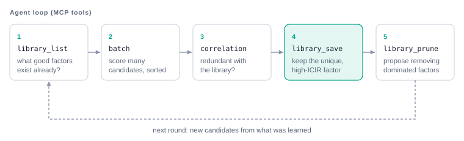

# MCP Server

The server now has **40 tools**, including eight FactorDB tools and 21 durable backend/dataset/session/experiment
tools. See the [agent research guide](agent-research.md) for their workflow and recovery semantics.

`assay_research_audit` returns read-only, evidence-linked checks for a human or agent
judge. See [research audit](research-audit.md) for its scope, paging and snapshot pinning.

The MCP server exposes Assay's evaluate→library loop as Model Context Protocol tools that LLM
agents call to drive autonomous alpha mining. Built on the high-level **FastMCP** API
([`src/assay/mcp/server.py`](../../../src/assay/mcp/server.py)).

## Public endpoint

Connect remote agents to **`https://assay.qfinverse.com/mcp/`** using Streamable HTTP.
Send a personal/service key as `Authorization: Bearer …` or `X-API-Key`. The model
provider key and Assay's access key are separate credentials. This deployment does
not implement OAuth; the client must support sending these headers.

Connection metadata is available at
[`/.well-known/assay.json`](https://assay.qfinverse.com/.well-known/assay.json).
It reports the deployed tool count and schema digest. Research sessions persist
in the server database; MCP transport sessions themselves are stateless.

```python
import asyncio
import os
from assay.mcp.client import connect_mcp

async def main():
    async with connect_mcp(url="https://assay.qfinverse.com/mcp/",
                           api_key=os.environ["ASSAY_MCP_API_KEY"]) as session:
        tools = await session.list_tools()
        print([tool.name for tool in tools.tools])
        print(await session.call_tool("assay_backend_list", {"probe": True}))

asyncio.run(main())
```

For research, use dataset → research session → experiment → inspection/decision.
`assay_experiment_run` uses default panel/factor reuse and records each attempt.
Use compact context and paginated experiment/history reads for routine inspection.
The immediate run/replay result still includes the full saved attempt for compatibility.
Authenticated researchers currently share one workspace.

Deployment and post-release checks: [deployment guide](deployment.md).

## Local execution

```bash
python -m assay.mcp.server                          # stdio (Claude Desktop / local agents)
python -m assay.cli serve-mcp --transport http --port 8001 # shared authenticated HTTP app
```

Install `.[api,mcp]` for HTTP mode. Stdio remains available with the MCP extra alone.
Prepared local market data requires no vendor credentials. Legacy `--transport sse`
is restricted to loopback development; public deployments use the shared HTTP app.

## Evaluation and library tools (11)

| Tool | Purpose |
|---|---|
| `assay_evaluate` | Evaluate one factor → `FactorReport` (qlib or Python syntax) |
| `assay_batch` | Evaluate many factors in parallel, sorted by `rank_icir` (prefer over a loop) |
| `assay_lint` | Data-free syntax check of an expression (dialect, fields, operators, diagnostics) |
| `assay_universes` | List available universes with symbol counts and default |
| `assay_portfolio_backtest` | Full portfolio backtest of a factor → compact `PortfolioReport` |
| `assay_library_list` | List library factors with filters (check redundancy before generating) |
| `assay_library_get` | Full `FactorReport` for one factor |
| `assay_library_save` | Save a report to the library |
| `assay_library_correlation` | Pairwise correlation between factor IDs |
| `assay_library_prune` | Identify / remove redundant factors |
| `assay_system_status` | Data freshness + cache statistics |

`assay_evaluate`'s description is enriched at runtime with the live operator schema
(`assay.engine.operator_schema()`), so agents see the available operators inline.

## Claude Desktop config

`~/.config/claude/claude_desktop_config.json`:

```json
{
  "mcpServers": {
    "assay": {
      "command": "python",
      "args": ["-m", "assay.mcp.server"],
      "env": { "ASSAY_DATA_DIR": "data_2025_2026h1" }
    }
  }
}
```

## Typical agent loop




Design contract: [architecture.md](../design/architecture.md) §6.
