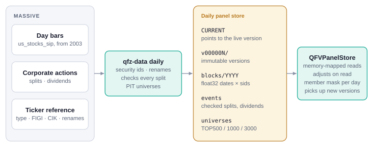

# US data from QFinVerse

On assay.qfinverse.com, US universes read the daily panel store that QFinVerse builds
from MASSIVE: end-of-day bars from September 2003, splits and dividends, and the
MASSIVE ticker reference. Assay does not ingest US data itself in this setup.



## Setup

```bash
export ASSAY_QFV_PANEL_DIR=/srv/qfinverse/data/daily_panel   # the store's root (holds CURRENT)
assay serve-api
```

The reader is vendored in `src/assay/data/qfv_panel` (format `qfv-daily-panel/1`);
`scripts/sync_qfv_panel.py` copies it again from a QFinVerse checkout. QFinVerse
updates the store every trading day at 21:45 New York time; Assay switches to the new
version on its next request, and results cached for the old version are not reused.

## Universes

| Universe | Members |
|---|---|
| `TOP500`, `TOP1000`, `TOP3000` | most liquid common stocks on the first trading day of each month |
| `SP500`, `NASDAQ100` | dated index histories, matched to QFinVerse securities |

The `TOP` universes rank by median dollar volume over the previous 63 trading days
(at least 50 days traded, last close at least $5). ETFs, ADRs, preferreds, warrants,
units and rights are left out. Membership uses only earlier data and keeps securities
that later delisted.

An evaluation covers every security that was a member at any time in the period and
scores it only on the days it was a member. A universe read from the members on the
last day would leave out every stock that dropped out; on NASDAQ100 over 2016–2026
that flips the sign of low-volatility and range factors.

## Securities

Bars carry tickers only, so each security has a permanent id:

- a ticker that comes back after more than 63 trading days without a bar is a new
  security; the older one is labelled `TICKER~YYYY-MM` (for example `ABC~2004-03`);
- renames are one security when the MASSIVE ticker history or a shared composite FIGI
  says so (`FB` → `META`), or when a delisted and a new common stock share a CIK and
  the price carries on within 25% (`COH` → `TPR`).

A ticker in an expression or a chart means the security that held it on the last day
of the window.

## Corporate actions

Prices are stored as traded and adjusted when read, onto the share basis of the last
day of the window. Only events with an ex-date inside the window are applied, so a
backtest that ends in the past never sees a later split.

| Field | Meaning |
|---|---|
| `open high low close` | split- and dividend-adjusted (total return basis) |
| `volume` | split-adjusted |
| `transactions` | as reported |
| `dvol` | close × volume, as traded |
| `ret` | daily total return, the same in every window |

Every split is checked against the prices before it is used:

| Status | Meaning | Applied |
|---|---|---|
| `ok` | prices jump by the split ratio on the ex-date | yes |
| `moved` | the jump is a few days off the vendor's date; the split moves there | yes |
| `no_jump` | no such jump within 10 trading days: already adjusted, or never happened | no |
| `small` | ratio within 10% of 1:1 (stock dividends) | yes |

Dividends are applied as `1 − cash / previous close`. A dividend is skipped when it
is not paid in USD, when it is more than half the price (nearly always a unit error),
or when there is no close in the 15 days before the ex-date.

## Speed

Panels are dense float32 arrays by year, memory-mapped. `TOP500` over 2016–2026 loads
in about 0.3 s and all of `TOP3000` over 2010–2026 in about 3 s. Six factors on
`SP500` over ten years evaluate in about 11 s, against 54 s on the per-ticker parquet
store.
