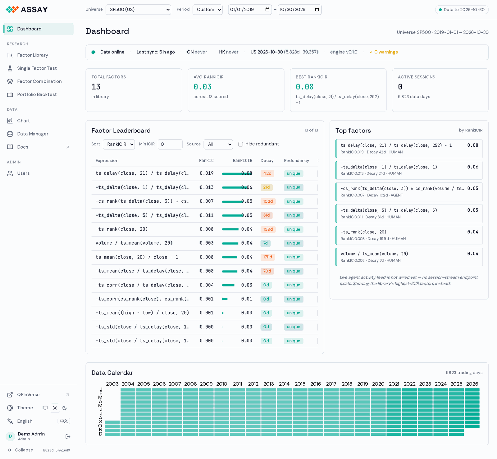
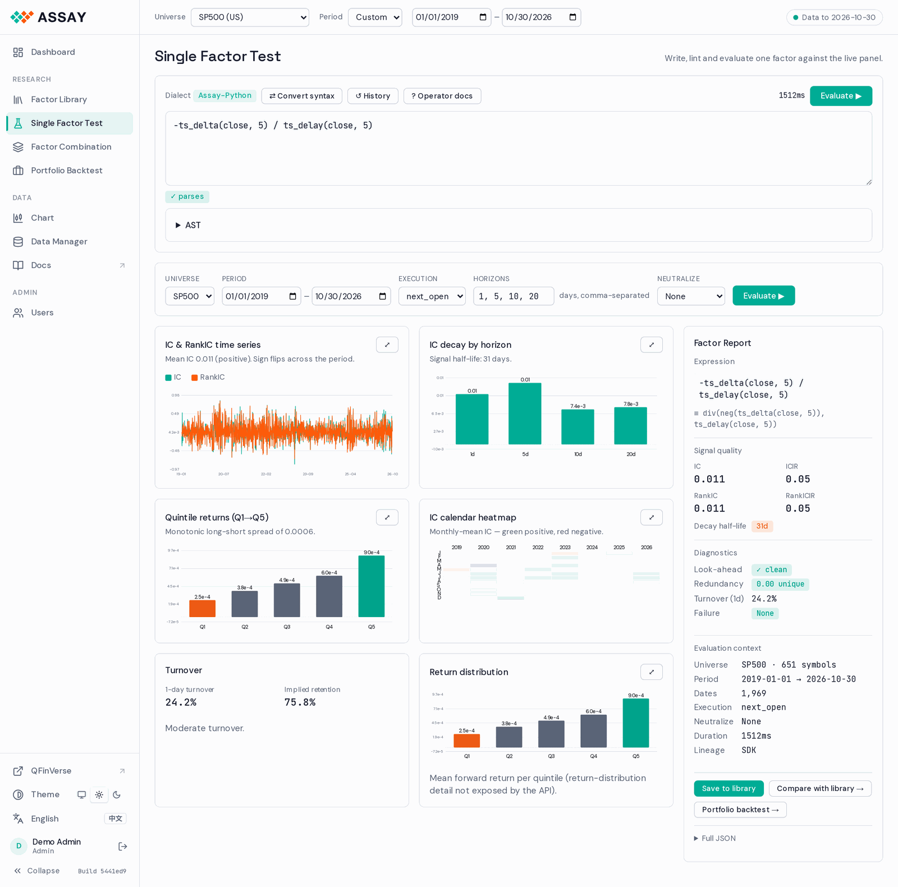
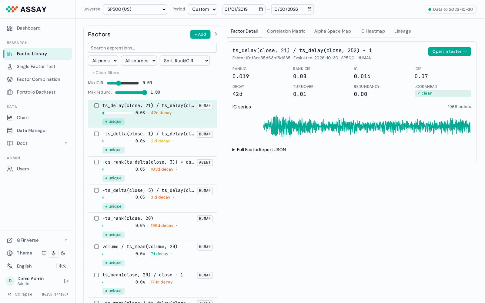
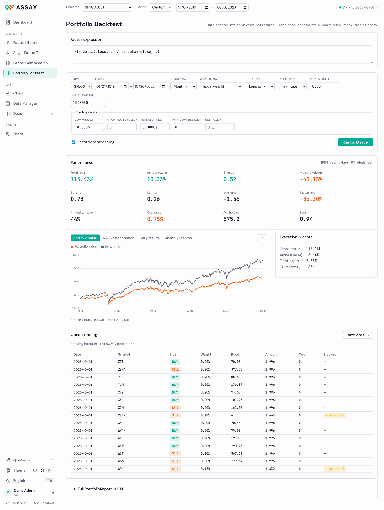
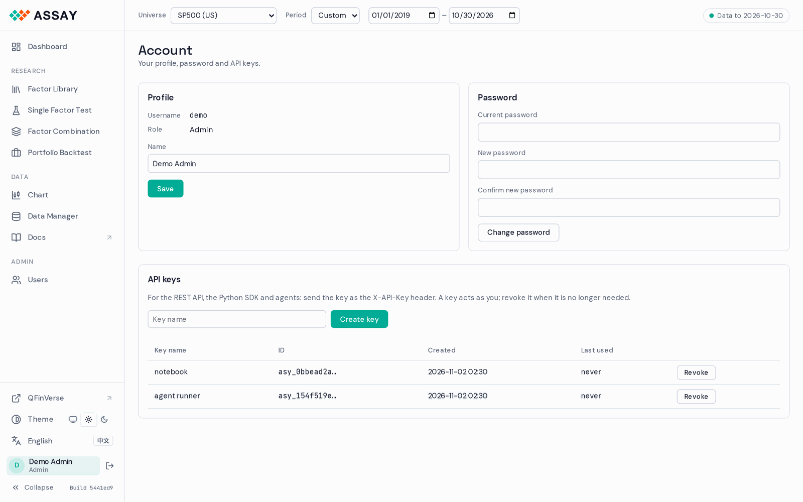
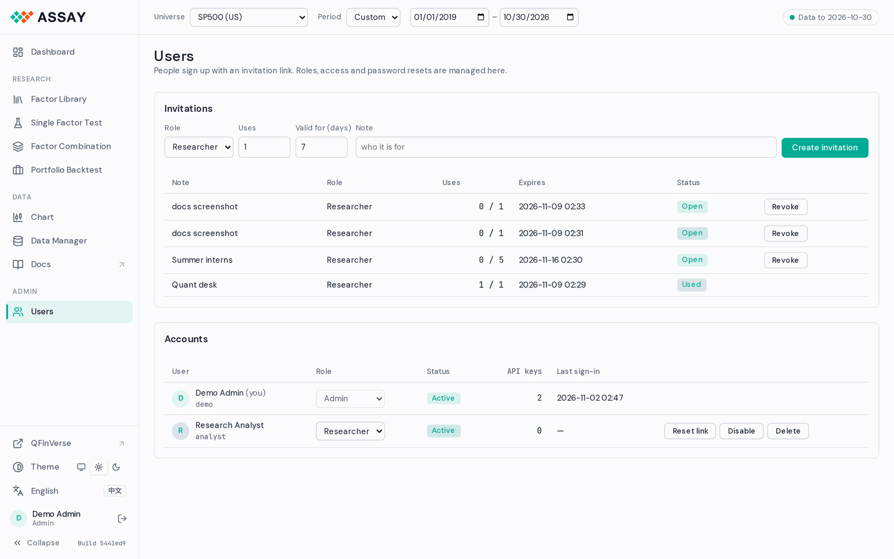

# WebUI

The console is served by the API server itself: no install, no build step. The code is in
[`src/assay/api/static/`](../../../src/assay/api/static/); the design notes are in
[the WebUI design doc](../design/webui.md).

```bash
python -m assay.cli serve-api --port 8000      # then open http://localhost:8000
```

On assay.qfinverse.com you sign in first; see [Accounts](#accounts) below.

## Layout



- **Sidebar.** Pages in three groups (Research, Data, Admin), then QFinVerse, theme, language,
  your account and *Collapse*. *Docs* opens the Doc Hub in a new tab. The bottom line shows
  the running build.
- **Context bar.** Universe and period apply to every page. The pill on the right shows how
  far the data goes; amber or red means stale or unreachable.
- Theme (system, light, dark) is shared with QFinVerse. Charts redraw after a switch.

## Pages

**Dashboard.** Data status, four KPI cards, the factor leaderboard (sort, minimum ICIR,
source, hide redundant), the top factors and a calendar of trading days with data.

**Single Factor Test.** Write an expression in qlib or Python syntax; it is checked as you
type and the parse tree is one click away. *Evaluate* (or Cmd/Ctrl+Enter) streams the
results: IC and RankIC over time, decay by horizon, quintile returns, IC by month, turnover,
and a summary with a suggestion. *Save* puts the report in the library; *Portfolio backtest*
opens the next step with the same factor.



**Factor Library.** Every saved factor, with search and filters. Tabs: factor detail,
correlation matrix (with a prune preview), alpha-space map, IC heatmap and lineage.



**Factor Combination.** Pick factors, choose a method (equal weight, IC-weighted, linear and
tree models where installed) and score the composite on train, validation and test
periods. Runs can be saved and reloaded.

**Portfolio Backtest.** Turns a factor into a long or long-short book with rebalancing,
weights, limits and costs, and reports NAV, Sharpe, drawdown, turnover and cost drag.



**Chart.** Daily bars for one symbol, with the adjustment mode and a factor overlay.

**Data Manager** (admins). Sources, ingest jobs, schedules and the cache. On a server that
reads US data from QFinVerse, US needs no jobs here.

## Accounts

When the server runs with accounts (`ASSAY_ACCOUNTS=1`, as on assay.qfinverse.com):

- **Sign-up is by invitation.** Open the link an admin sent, pick a username and a password of
  at least 10 characters.
- **Account** (click your name in the sidebar): change your name and password, and manage API
  keys. A new key is shown once; send it as `X-API-Key` from scripts and agents.
- **Users** (admins): create invitations (role, number of uses, days valid), change roles,
  disable or delete accounts, and issue one-time password reset links.





## Tips

- An evaluation needs data for the whole window: a 20-day factor needs 20 days of history
  before the first date, or it comes back empty with an `ALL_NAN` diagnostic.
- After a deployment, a reload picks up the new build (assets are revalidated on every load).
- The live agent feed on the Dashboard is not wired yet; the right column shows the top
  factors instead.
